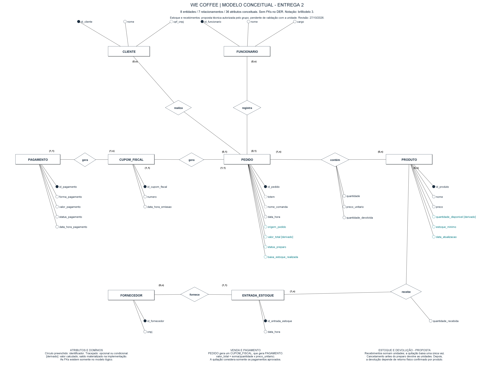
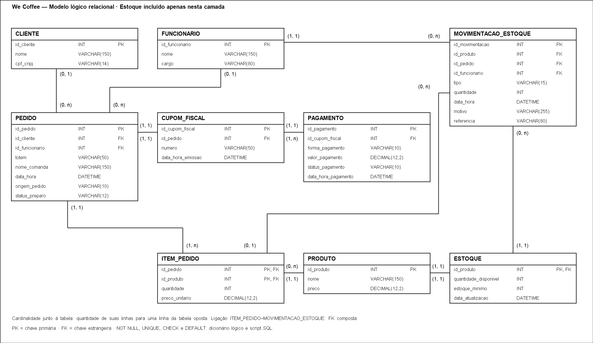

# We Coffee — Entrega 2: modelo lógico, implementação SQL e apresentação final

Relatório técnico final do projeto de banco de dados da unidade We Coffee da Av. Paulista, 1111. **SGBD: MySQL 8.** Revisão técnica/documental em **10/11/2026**, solicitada pelo integrante e registrada na Seção 6.8.

> **Situação da revisão:** SQL executável e verificações registradas neste relatório. Ainda existem pendências de abrangência do modelo e comprovação da entrevista. Este registro não declara a entrega integralmente pronta.

## Integrantes

| Nome | RGM |  Usuário GITHUB |
|----|----|----|
| Guilherme Souza Lima | 46899502 | Guilherme-DEV-ALT |
| João Victor Moidano do Valle | 46576461 | JoaoVictorValle |
| Gabriel Amorim Sartori | 46832939 | gabrielamorimsartori28-collab |
| Guilherme Cau Guateli | 46736069 | CacauG |
| Matheus Fernandes Andrade | 46754539 | 01Theuz |

## 1. Relatório técnico final

### Escopo e navegação

[Levantamento](./levantamento/levantamento.md) · [Dicionário](./index.html) · [SQL completo](./docs/script.sql) · [Avaliação da Entrega 1](./levantamento/avaliacao_entrega1.md)

O projeto cobre atendimento, clientes, funcionários, produtos/preços, pedidos, itens, cupom, tentativas de pagamento e estoque de produtos prontos de uma unidade. Compras/fornecedor, contas a pagar, campanhas, escala, logs, autenticação e registro de fechamento não têm implementação completa. Algumas dessas atividades existem ou são requisitos declarados; sua ausência não é justificada apenas por falta de acesso e constitui risco frente ao escopo integral exigido pelo enunciado.

## 1.1 Revisão do modelo conceitual — Caso A

### Nome e natureza da organização

A organização escolhida é a **MOONLIGHT COFFEE CAFETERIA LTDA.**, que utiliza o nome comercial **We Coffee**. A We Coffee atua no segmento de cafeterias, com comercialização de alimentos e bebidas e uma proposta de experiência diferenciada para os clientes.
**CNPJ:** 34.706.031/0001-84
**Site:** https://wecoffee.com.br/
**Unidade analisada:** Avenida Paulista, 1111 — Bela Vista, São Paulo/SP.

### Contexto e porte

Conforme atualização confirmada pelo grupo em **28/10/2026**, a composição informada é de **8 funcionários da cafeteria, 4 profissionais de limpeza terceirizada e 3 seguranças terceirizados**, totalizando **15 pessoas**. Essa informação substitui a estimativa anterior de aproximadamente seis funcionários da cafeteria.

**Volume operacional informado pelo grupo em 10/11/2026:** mais de **100 pedidos por dia** e mais de **5 mil pedidos por mês**. São limites aproximados relatados pelo grupo, sem extração dos sistemas internos. A operação é de uma unidade de empresa com fins lucrativos. Os oito funcionários da cafeteria justificam os oito cadastros fictícios de FUNCIONARIO; os sete terceirizados não fazem parte desse cadastro de vendas. A massa de 60 pedidos em dois meses é uma amostra funcional selecionada, não o movimento integral da unidade.

Não foram fornecidos os totais reais de clientes cadastrados, itens do cardápio ou saldos de estoque. Esses cadastros e valores da carga continuam fictícios.

As quantidades de cada grupo foram confirmadas nesta conversa. A distribuição dos dias de trabalho e das folgas apresentada no [levantamento detalhado](./levantamento/levantamento.md) continua sendo **fictícia**, sem representar a escala real da unidade ou das prestadoras.

A unidade trabalha com diferentes formas de atendimento:

- **Totem de autoatendimento:** o próprio cliente realiza o pedido e o pagamento.
- **Balcão:** o funcionário registra o pedido e informa o nome do cliente. As vendas utilizam um registro que permanece aberto para o atendimento, sem solicitar `id_funcionario` a cada venda; o vínculo do pedido com um funcionário cadastrado é opcional.
- **Delivery:** o cliente realiza o pedido e o pagamento pela plataforma de entrega.
Após o registro do pedido, é gerada uma comanda para auxiliar no processo de preparação e entrega.

### Problemas e necessidades identificados

**P1 — Consolidação gerencial:** durante a entrevista com o gerente da unidade, foi identificado que as informações de vendas podem ser consultadas, porém tem uma certa dificuldade para **consolidar essas informações em um fechamento mensal que permita avaliar claramente o desempenho da loja**.

**P2 — Disponibilidade dos produtos:** também foi observado que o controle de disponibilidade dos produtos depende da atualização do estoque. Quando um produto acaba, a equipe verifica a situação e atualiza sua disponibilidade para que os canais de venda reflitam a informação.

Dessa forma, o projeto busca estruturar os dados de pedidos, produtos, documentos fiscais e pagamentos para facilitar consultas e futuras análises gerenciais. O estoque de produtos prontos integra o modelo lógico e o SQL, conforme as regras confirmadas pelo grupo em 01/11/2026. Por orientação do grupo, não é desenhado no DER conceitual.

### Justificativa da escolha

A We Coffee foi escolhida por apresentar um cenário real de operações comerciais com diferentes canais de atendimento, vendas, pagamentos, controle de estoque e relacionamento com fornecedores. A escolha se apoia no acesso do grupo à unidade e na variedade dos processos de atendimento, pagamento e abastecimento observados.

O grupo teve acesso à unidade e realizou entrevista com o gerente, além de observação dos processos e registros fotográficos.

### Evidências da organização

Foram obtidas evidências da existência e do acesso à organização, incluindo:

- endereço da unidade;
- site oficial;
- rede social da organização;
- contato do gerente da unidade: Daniel Porrino (+55 11 95208-6022)
- contato do auxiliar geral: Leandro Viana (responde por tudo quando o seu superior não está presente) | (+55 11 97770-7658)
- entrevista com o gerente;
- entrevista com o auxiliar geral;
- registros fotográficos da unidade.
- vídeos mencionados no relato original, não disponibilizados como arquivos no repositório e não utilizados como comprovação nesta revisão.
- Link da loja: https://share.google/shs5jxNxnNAmYuQjz

---

### Relato das entrevistas e comprovação

O grupo relata entrevista presencial e observação da rotina da unidade da Av. Paulista, 1111. Os responsáveis identificados são Daniel Porrino, gerente, e Leandro Viana, auxiliar geral; os contatos estão acima. Mantém-se a mesma organização da Entrega 1 (**Caso A**).

| Registro | Conteúdo e origem |
|---|---|
| Entrevista inicial com o gerente | Realizada em **30/08/2026** com Daniel Porrino, gerente. Constatou-se dificuldade na consolidação mensal e foram descritos os canais de atendimento. Data informada pelo integrante em 10/11/2026. |
| Entrevista com Leandro Viana | Realizada em **08/11/2026**, relatada pelo grupo em **09/11/2026**: fechamento diário exclusivo por gerentes; cancelamento da nota e do pedido; estorno imediato pelo cartão e balanceamento automático no sistema existente. |
| Participação | Os cinco integrantes estão identificados na tabela inicial. O material não discrimina nominalmente quais participaram de cada entrevista; as fotos não foram utilizadas para identificar pessoas por inferência. |
| Respostas dos responsáveis | Canais, identificação da comanda, pagamento dividido e procedimentos de fechamento e cancelamento documentados nos processos abaixo. |
| Observação relatada pelo grupo | Registro do pedido, geração de comanda e acompanhamento de disponibilidade. O assistente não realizou visita nem observação presencial. |
| Fotografias disponíveis | Duas fotos JPG do grupo no local, incorporadas ao repositório. Não há identificação documental de qual responsável aparece em cada foto nem vinculação de cada foto à entrevista de 08/11. O grupo deve conferir essa comprovação antes da submissão. |
| Atualização de volume | Em **10/11/2026**, o grupo informou mais de 100 pedidos/dia e mais de 5 mil/mês. Não houve fornecimento de relatórios internos nesta revisão. |

O [levantamento completo](./levantamento/levantamento.md) organiza processos, achados, fontes, escala fictícia e limites do acesso. Ele é um relato organizado a partir do material do grupo, sem criar entrevista, visita ou confirmação inexistente.

### Tratamento dos apontamentos da Entrega 1

A [avaliação recebida do professor](./levantamento/avaliacao_entrega1.md), fornecida pelo grupo em **10/11/2026**, atribuiu **0,98/1,60** à Entrega 1. A conferência abaixo distingue correções verificáveis de pendências. Não equivale a uma nova avaliação do professor.

| Apontamento da correção da E1 | O que mudou / situação atual | Por quê |
|---|---|---|
| Nome Readme.md aceito por exceção; dois relatórios divergentes | Arquivo da raiz padronizado para **README.md**; não existe outro README em WECOFFE no estado atual. | O enunciado exige o relatório da raiz da main. |
| Cinco integrantes e RGM | Tabela mantida e usuário JoaoVictorValle padronizado sem acento. | Permite identificar os integrantes no histórico. |
| Organização real e caracterização aceitas | Razão social, CNPJ, unidade, canais e contatos mantidos; porte atualizado para 8 funcionários e 7 terceirizados; volume acrescentado conforme relato de 10/11. | Preservar a organização da E1 e usar números atuais informados pelo grupo. |
| Ausência de fotos; inconsistência entre “a gerente” e Daniel | Duas fotos JPG disponíveis e vinculadas; Daniel descrito como gerente. A associação nominal das fotos à entrevista permanece a conferir. | Evidência precisa estar no repositório; foto de visita não comprova, sozinha, quem foi entrevistado. |
| Processos superficiais; falta de cardápio/preços | Cadastros, alterações de nome/preço e preço histórico detalhados em RF04/RF08 e RN04/RN12. | Explicitar os dados que o modelo e o SQL usam. |
| Cancelamento/estorno ausentes | Processo documentado com a entrevista de 08/11; CANCELADO e Estornado no modelo. Situação fiscal, evento de estorno e integração externa continuam sem implementação. | Preservar histórico e distinguir representação acadêmica da automação operacional relatada. |
| Contas a pagar ausentes | Falta de acesso declarada; não implementadas. | Não inventar dados ou concluir que o processo inexiste. A abrangência exigida permanece um risco da entrega. |
| Recebimento, disponibilidade, perdas e estoque | Abastecimento diário relatado; estoque pronto, entradas, perdas e ajustes implementados no lógico/SQL. Fornecedor/compras foram retirados por decisão anterior do grupo. | Há controle quantitativo, mas retirar um processo do recorte não comprova que ele não exista. |
| Escala ausente | RF25 e semana-modelo fictícia documentados; sem tabelas ou representação no DER. | O exemplo não deve ser apresentado como funcionalidade implementada. |
| Regras legais, cupom fiscal e cancelamento insuficientes | Cupom fiscal, histórico, privacidade, acesso proposto e limites sobre validade documentados. Sem dados de lotes/validade, integração fiscal ou autenticação implementados. | Não confundir orientação geral e proposta com execução pela unidade ou pelo banco. |
| Fornecedor alternativo e programa do aplicativo parciais | Fornecimento único relatado; campanha CITI registrada apenas como informação. Programa do aplicativo e condições desconhecidas não foram presumidos. | Condições de operação e autorizações exigem levantamento humano. |
| Faltavam logs, matriz de acesso/retenção e leitura das expressões no HTML | Seções 5, 6 e 7 presentes em index.html. Logs e perfis são propostas documentadas, sem tabelas/controle efetivo. O PDF de referência do dicionário não foi fornecido. | Corrige a documentação, sem afirmar conformidade exata com o exemplo indisponível. |
| DER sem atributos | Imagem atual possui 26 atributos conceituais, com identificadores e quantidade/preço no relacionamento CONTÉM. | Torna explícitos os dados representados, sem desenhar FKs no conceitual. |
| Relacionamento espúrio “É pago por” entre PEDIDO e ITEM_PEDIDO | Não existe na imagem atual; CONTÉM liga PEDIDO e PRODUTO, e CUPOM_FISCAL liga os pagamentos. | Remove duplicidade semântica e separa item de pagamento. |
| Entidades de compras/estoque consideradas essenciais na E1 | O DER atual tem seis entidades e não inclui estoque, campanhas, escala e fechamento; estoque existe somente a partir do lógico por decisão anterior. **Pendência de alinhamento**, sem alegação de correção integral. | O enunciado pede cobertura da organização e coerência do conceitual ao SQL. |
| Justificativa técnica e uso de IA aceitos | Justificativas preservadas; histórico de IA consolidado na Seção 6, com o pedido desta revisão transcrito. | Manter rastreabilidade das decisões e transparência do apoio recebido. |

### DER conceitual revisado

**Aplicativo informado no histórico:** brModelo 3. São seis entidades, cinco relacionamentos e 26 atributos conceituais, sem chaves estrangeiras no desenho. Quantidade e preço histórico são atributos externos do losango CONTÉM. A versão disponível no repositório é a [imagem PNG](./WECOFFE/Modelo_Conceitual_WeCoffee_BRModelo.png).

O conceitual atual não apresenta identificador composto em uma entidade, embora o enunciado o indique como obrigatório. A PK composta de ITEM_PEDIDO consta do modelo lógico, mas não deve ser usada como comprovação de um identificador composto desenhado no conceitual. A extensão de estoque somente no lógico foi preservada por ser uma decisão anterior do grupo; essa diferença e os requisitos ainda não modelados estão identificados na descrição do escopo e nos requisitos deste relatório.

### Processos de negócio

#### Cadastro de clientes, funcionários e produtos

O sistema proposto mantém os seguintes cadastros:

- **CLIENTE:** identificado por `id_cliente`, com `nome` obrigatório e `cpf_cnpj` opcional. Quando informado, o documento deve ser único.
- **FUNCIONARIO:** identificado por `id_funcionario`, com `nome` e `cargo` obrigatórios. O cadastro permite associar funcionários aos pedidos de balcão que registrarem, sem tornar o vínculo obrigatório para realizar a venda.
- **PRODUTO:** identificado por `id_produto`, com `nome` e `preco` de venda atual obrigatórios. O preço deve ser maior que zero.

O grupo informou a retirada de compras e do cadastro de FORNECEDOR do recorte, em razão de um fornecimento único inteiramente vinculado à empresa. Em atualização de 28/10/2026, confirmou abastecimento diário. A justificativa do recorte, os limites de acesso às informações e as propostas de controle estão no [levantamento detalhado](./levantamento/levantamento.md).

#### Atendimento e registro do pedido

O pedido pode ser realizado por totem, balcão ou delivery. Cada PEDIDO possui `id_pedido`, `data_hora`, `origem_pedido` e `status_preparo`.

Os dados complementares dependem do atendimento:

- Quando a origem for **TOTEM**, o atributo `totem` identifica o equipamento utilizado.
- Quando a origem for **BALCÃO**, as vendas utilizam um registro que permanece aberto para o atendimento, sem solicitar `id_funcionario` a cada venda. A associação do pedido a um funcionário cadastrado é opcional.
- Quando a origem for **DELIVERY**, não são obrigatórios o funcionário de balcão nem a identificação de totem.
- O vínculo com um cliente cadastrado, representado por `id_cliente`, é opcional.
- O nome utilizado para identificação e chamada é registrado em `nome_comanda`, mesmo quando não existe cliente associado. Quando esse nome não for informado, utiliza-se `id_pedido`.

#### Associação dos produtos e cálculo do pedido

Cada pedido deve conter pelo menos um produto cadastrado, identificado por `id_produto`.

No relacionamento **PEDIDO — CONTÉM — PRODUTO**, são registrados:

- `quantidade`: número inteiro de unidades daquele produto no pedido, obrigatoriamente maior que zero;
- `preco_unitario`: preço praticado para aquele produto naquela venda, preservado mesmo quando o preço atual do cadastro for alterado.

O atributo `valor_total` de PEDIDO é derivado pela fórmula:

`valor_total = soma(quantidade × preco_unitario)`

O cálculo considera todos os produtos associados ao pedido. O total não é informado livremente e não exige um atributo de subtotal.

#### Emissão do documento fiscal

Todo pedido gera exatamente um documento fiscal, representado por CUPOM_FISCAL e denominado nota fiscal do pedido neste trabalho.

O documento possui:

- `id_cupom_fiscal`: identificador único do cupom;
- `id_pedido`: referência obrigatória e única ao pedido que gerou o documento;
- `numero`: número obrigatório e único no escopo da unidade;
- `data_hora_emissao`: data e horário obrigatórios da emissão.

Cada cupom pertence a um único pedido e reúne os registros de pagamento dessa compra.

#### Registro das tentativas e divisão do pagamento

Cada tentativa é registrada em PAGAMENTO com:

- `id_pagamento`;
- `id_cupom_fiscal`;
- `forma_pagamento`;
- `valor_pagamento`;
- `status_pagamento`;
- `data_hora_pagamento`.

As formas previstas são **PIX, Crédito, Débito e Dinheiro**. O valor de cada tentativa deve ser maior que zero.

Um cupom pode possuir vários registros, permitindo dividir a conta entre diferentes formas de pagamento ou realizar uma nova tentativa após uma recusa.

Somente registros com `status_pagamento = Aprovado` compõem o valor pago. Registros **Recusado** ou **Estornado** permanecem no histórico e são excluídos dessa soma.

#### Preparação e entrega

O acompanhamento utiliza `PEDIDO.status_preparo`, com os estados:

| Estado | Significado |
|---|---|
| RECEBIDO | Pedido registrado, aguardando confirmação da quitação para liberação ao preparo. |
| EM_PREPARO | Pedido liberado e em preparação ou separação dos produtos. |
| PRONTO | Preparação ou separação concluída; pedido disponível para entrega. |
| ENTREGUE | Pedido entregue ao cliente. |

A liberação para preparo depende da igualdade entre o `valor_total` e a soma dos pagamentos aprovados do cupom.

A identificação para entrega utiliza `nome_comanda` ou, quando ausente, `id_pedido`.

#### Cancelamento e estorno — procedimento confirmado na entrevista

Segundo o relato do auxiliar geral **Leandro Viana**, em entrevista realizada em **08/11/2026** e informada pelo grupo em **09/11/2026**, o procedimento envolve o **cancelamento da nota fiscal e do pedido**, com **estorno realizado na hora pelo cartão do cliente**. O sistema existente faz automaticamente o balanceamento dos valores e o estorno. Essa informação confirma o processo operacional antes tratado como proposta a validar.

No modelo acadêmico, o cancelamento é representado pelo estado **CANCELADO** em `PEDIDO.status_preparo`, impedindo a continuidade do preparo ou da entrega. O `status_pagamento` passa para **Estornado** após a confirmação efetiva da devolução. Pagamentos recusados não exigem estorno. O pedido, seu cupom e seus pagamentos permanecem no histórico; cancelamento não significa exclusão dos registros.

Como escolha técnica do recorte atual, cada registro de pagamento é estornado integralmente. Se a confirmação da devolução ainda não tiver sido recebida, o pagamento permanece **Aprovado** e a auditoria aponta devolução pendente. Esse é um estado de exceção para conferência, e não o fluxo normal de estorno imediato relatado na entrevista.

O SQL representa a situação do pedido e do pagamento, mas ainda não armazena a situação de cancelamento do documento fiscal nem o evento/data do estorno. A integração com os serviços fiscal e de cartão e o balanceamento automático do sistema existente não estão implementados no projeto. Permanecem a detalhar os estágios em que se pode cancelar, quem pode autorizar/operar o estorno, as regras para PIX e Dinheiro, pagamentos divididos ou estornos parciais e eventuais devoluções após um fechamento.

#### Consulta e análise de vendas

As consultas relacionam:

- **PEDIDO:** `id_pedido`, `data_hora`, `origem_pedido`, `nome_comanda`, `status_preparo` e `valor_total`;
- **PRODUTO e CONTÉM:** identificação e nome do produto, `quantidade` e `preco_unitario`;
- **CUPOM_FISCAL:** identificação do documento, `numero` e `data_hora_emissao`;
- **PAGAMENTO:** identificação da tentativa, `forma_pagamento`, `valor_pagamento`, `status_pagamento` e `data_hora_pagamento`.

Esses dados permitem consultar compras, documentos emitidos, pagamentos divididos, recusas, valores aprovados e situações financeiras.

Na consolidação mensal, um pedido com vários produtos ou pagamentos não deve ter seu total contado repetidamente. Conforme a entrevista de **08/11/2026** com o auxiliar geral, o **fechamento das vendas ocorre ao final de cada dia e é realizado exclusivamente pelos gerentes**. A consolidação mensal deve apoiar a análise dos resultados diários.

##### Confirmações e consequências para o projeto — 09/11/2026

| Informação confirmada na entrevista | Consequência no projeto |
|---|---|
| Fechamento ao final de cada dia. | Periodicidade diária formalizada em RF16, RF31 e RN33; a análise mensal continua sendo necessária. |
| Apenas gerentes realizam o fechamento. | Operação de fechamento restrita à Gerência na matriz de acesso. Consultar um relatório não equivale a executar um fechamento. |
| Cancelamento da nota fiscal e do pedido. | RF18 e RN23 passam a se apoiar no relato; o banco preserva o histórico. O registro específico da situação fiscal ainda exige ampliação do modelo. |
| Estorno na hora pelo cartão do cliente. | RF18 e RN24 deixam de tratar a existência desse procedimento como hipótese. A confirmação da devolução continua necessária para registrar Estornado. |
| O sistema existente faz o balanceamento e o estorno automaticamente. | Automação documentada como prática relatada da unidade; o SQL acadêmico não executa transações na operadora nem no sistema fiscal. |

**Referência temporal das consultas:** a periodicidade diária foi confirmada, mas a entrevista não definiu qual campo de data o sistema existente utiliza nem um horário exato de corte. As consultas acadêmicas continuam usando `PEDIDO.data_hora` para vendas e `PAGAMENTO.data_hora_pagamento` para tentativas, com início inclusivo e fim exclusivo. Para consultar um dia civil, usar o início desse dia e o início do seguinte. Esse filtro é uma convenção analítica do projeto, não uma confirmação do regime contábil ou de reabertura do fechamento da unidade.

O fechamento gerencial efetivo, com identificação do gerente, instante de execução e valores preservados, ainda não possui registro próprio no banco. Autenticação, bloqueio por perfil e preservação de fechamentos históricos permanecem pendentes de implementação. O vínculo opcional de funcionário no pedido de balcão não identifica nem autoriza o responsável pelo fechamento.

#### Conferência dos processos típicos e justificativas do recorte

A pesquisa sobre cafeterias foi utilizada para ampliar as perguntas do levantamento. O estudo do [Sebrae sobre o perfil das cafeterias brasileiras](https://agenciasebrae.com.br/dados/muito-alem-do-cafezinho-com-pao-de-queijo-conheca-o-perfil-das-cafeterias-brasileiras/) aborda preparo, qualificação da equipe, padrões de qualidade, fornecedores e relacionamento com clientes. Essas referências setoriais não comprovam como a We Coffee analisada realiza cada atividade. A matriz abaixo combina o relato já documentado, as informações complementares do grupo e os processos prováveis sugeridos pela pesquisa e pela IA.

| Processo | Situação na organização e dados envolvidos | Tratamento no trabalho e confirmação necessária |
|---|---|---|
| Cadastros de clientes, funcionários e produtos | Já descritos: identificadores, nomes, documento opcional do cliente, cargo e preço atual do produto. | Incluídos no modelo e detalhados nas Seções 2.1, 3 e 5. |
| Atendimento, pedido e venda | Já descritos: origem, equipamento quando aplicável, nome de comanda, produtos, quantidades e preços praticados. | Incluídos, independentemente de sua relação direta com o problema de fechamento mensal. |
| Documento fiscal e pagamentos | Número e data de emissão, forma, valor, situação e data de cada tentativa; cancelamento da nota e do pedido relatado na entrevista de 08/11/2026. | Incluídos. A ocorrência do cancelamento fiscal está confirmada; códigos, comprovantes, prazos e integração fiscal ainda precisam ser detalhados. |
| Preparação, separação e entrega | Já descritos: identificação do pedido e estados de preparo. | Incluídos. Receitas, ingredientes, produção de alimentos e procedimentos de qualidade ainda não foram detalhados. |
| Cancelamento e devolução financeira | Entrevista de 08/11/2026 confirma cancelamento da nota e do pedido, estorno na hora pelo cartão e balanceamento automático pelo sistema existente. | Processo confirmado; estados CANCELADO e Estornado representam seus efeitos no modelo. Permissões de estorno, outras formas de devolução e detalhes das integrações permanecem pendentes, conforme o [levantamento detalhado](./levantamento/levantamento.md). |
| Fechamento de vendas | Entrevista de 08/11/2026 confirma fechamento ao final de cada dia, exclusivamente pelos gerentes; permanece a dificuldade de consolidação mensal. | Periodicidade e responsabilidade confirmadas em RF31/RN33. Horário exato de corte, abertura de caixa, despesas, conciliação detalhada e tratamento após o fechamento ainda precisam de levantamento. |
| Contas a pagar | O grupo não conseguiu acesso às informações desse processo. Valores, vencimentos, credores, responsáveis e situação dos pagamentos não foram disponibilizados. | Processo registrado como informação não acessível ao grupo, sem dados financeiros ou funcionalidade modelados. A falta de acesso não comprova inexistência nem permite afirmar como a atividade é executada. |
| Compras e cadastro de fornecedor | O grupo informou um único fornecimento totalmente vinculado à empresa e solicitou retirar compras e FORNECEDOR do recorte. | Retirados como funcionalidade e cadastro próprios desta versão. Ainda é necessário confirmar quem solicita, compra e autoriza o fornecimento, inclusive se a gestão é centralizada. O abastecimento diário está confirmado, independentemente da existência de um cadastro local de fornecedor. |
| Abastecimento e recebimento | O grupo confirmou em 28/10/2026 que o abastecimento ocorre todos os dias. Horários, produtos, quantidades recebidas, responsáveis e forma de conferência não foram detalhados. | Frequência incluída no mapeamento como informação do grupo. Não se presume que todos os produtos sejam repostos todos os dias, que não existam sobras ou que o recebimento já esteja representado no banco. |
| Disponibilidade e estoque | Controle de produtos prontos e baixa na liberação para preparo confirmados pelo grupo em 01/11/2026. | Definido no [levantamento detalhado](./levantamento/levantamento.md) e implementado apenas nas camadas lógica e física, sem inclusão no DER conceitual. |
| Escala e organização da equipe | Nenhuma escala real foi localizada nos arquivos do projeto. O grupo solicitou um registro manual com pessoa, setor, vínculo, período e dias de trabalho/folga. | Funcionalidade de registro e consulta incluída em RF25, acompanhada de exemplo com 15 nomes e códigos fictícios no [levantamento detalhado](./levantamento/levantamento.md). Datas, horários e distribuição real da equipe continuam pendentes de levantamento. |
| Limpeza e conservação | O grupo informou serviço terceirizado com quatro pessoas. Ambientes atendidos, tarefas, frequência e responsável pela prestação ainda precisam ser detalhados. | Processo incluído no mapeamento. O quadro fictício demonstra apenas a distribuição dos dias; não representa contrato, checklist ou escala real da prestadora. |
| Segurança | O grupo informou serviço terceirizado com três pessoas. Postos, horários, responsáveis e registros de ocorrências ainda não foram informados. | Processo incluído no mapeamento. Contratos e gestão de pessoal da prestadora não foram modelados; confirmar quais dados a unidade precisa acompanhar. |
| Validade dos produtos | Segundo o grupo, não há controle específico de validade no recorte levantado, tendo sido apresentada como justificativa a reposição diária. Não foram obtidos detalhes sobre conferência de prazos, rótulos ou tratamento das sobras. | Justificativa documentada como relato, sem concluir que a reposição diária dispensa a conferência de validade. Confirmar quem realiza essa verificação e onde ela é registrada, conforme o [levantamento detalhado](./levantamento/levantamento.md). |
| Perdas e desperdício | O grupo não teve acesso às informações desse processo. Quantidades, motivos, datas e destinação das perdas não foram disponibilizados. | Registrado como limitação de acesso, sem afirmar perda zero ou inexistência de desperdício. O modelo lógico agora permite registrar perdas em unidades, sem supor acesso a ocorrências históricas reais. |
| Produção e controle de qualidade | Produtos preparados na unidade, ingredientes utilizados e procedimentos de qualidade ainda não foram detalhados. | Processo ainda a conferir. A reposição diária não permite inferir como ocorre a produção nem substituir o levantamento de qualidade e conservação. |
| Campanhas e parcerias | O grupo informou campanhas quase todos os meses, em função de parcerias com grandes empresas. Como exemplo, funcionários do banco CITI que gastam acima de R$ 39,00 recebem uma bebida na próxima visita, apresentando o cupom fiscal da compra. | Registro informativo incluído em RF24, conforme relato do grupo. O benefício é uma cortesia posterior; sua concessão e seu resgate não serão controlados pelo sistema nesta etapa. Condições ainda desconhecidas permanecem no [levantamento detalhado](./levantamento/levantamento.md). |
| Programas do aplicativo | Não foram confirmados programa de pontos, cashback, cupons próprios do aplicativo ou regras de fidelidade digital. | Permanecem pendentes de levantamento. A campanha do CITI não foi atribuída ao aplicativo, e a existência do canal DELIVERY não comprova um programa de fidelidade. |
| Divulgação e eventos | A pesquisa setorial indica relacionamento e comunicação com clientes, mas não foram detalhados os canais de divulgação das campanhas nem a existência de eventos nesta unidade. | Não incluídos como funcionalidades ou entidades enquanto não houver confirmação. Registrar se são executados pela unidade, pela empresa ou por terceiros. |

**Limite de cobertura:** ter um fornecedor único ou terceirizar um serviço não elimina a necessidade de mapear a atividade. As informações iniciais foram fornecidas pelo grupo em 28/10/2026 e o estoque foi atualizado em 01/11/2026, nesta conversa. Em 09/11/2026, o grupo acrescentou o relato da entrevista com o auxiliar geral realizada em 08/11/2026, confirmando fechamento diário e estorno pelo cartão. O assistente não participou da entrevista nem acessou registros internos. Contas a pagar e perdas permanecem documentados como informações não acessíveis, e não como processos inexistentes. Os processos confirmados ainda sem representação no modelo exigem posterior detalhamento dos requisitos, do dicionário e do DER.

##### Limites do levantamento e validade

O grupo informou que não conseguiu acesso aos dados de contas a pagar nem aos registros de perdas. Por esse motivo, o trabalho não descreve valores, documentos, responsáveis ou procedimentos desses processos. Essa limitação deve permanecer explícita na avaliação da cobertura do levantamento.

Sobre validade, o relato recebido foi de ausência de controle específico, justificada pela reposição diária. O abastecimento diário foi confirmado, mas não foram confirmados prazo de uso, data de preparo, identificação dos produtos ou destino das sobras. Assim, não se afirma que os produtos não tenham validade nem que todos sejam consumidos ou descartados no mesmo dia.

Como referência para a próxima conferência, a [cartilha de Boas Práticas para Serviços de Alimentação da Anvisa](https://www.gov.br/anvisa/pt-br/centraisdeconteudo/publicacoes/alimentos/manuais-guias-e-orientacoes/cartilha-boas-praticas-para-servicos-de-alimentacao.pdf) orienta verificar as condições e os prazos dos alimentos recebidos e identificar alimentos preparados armazenados com nome, data de preparo e validade. Portanto, a reposição diária não deve ser apresentada no trabalho como dispensa desses cuidados. A referência não comprova como a unidade executa a verificação; isso ainda precisa ser levantado.

##### Estoque de produtos prontos — definição concluída

Em **01/11/2026**, o grupo confirmou nesta conversa o controle por **produto pronto para venda**, em unidades inteiras, e a **baixa quando o pedido quitado é liberado para preparo**. O grupo também confirmou as regras de recebimento, saldo não negativo, perdas/ajustes com motivo, estoque mínimo e retorno somente de produtos aptos para revenda. Essas práticas são registradas como informações da unidade confirmadas pelo grupo; não houve nova visita ou acesso aos registros internos nesta revisão.

- Recebimentos acrescentam unidades ao saldo; perdas e ajustes negativos as retiram. Cada movimento registra produto, quantidade, data/hora, responsável pelo lançamento e motivo.
- A liberação exige quitação exata e saldo suficiente de todos os produtos. A baixa é integral e ocorre uma única vez por item, na mesma transação da liberação. Se faltar qualquer produto, toda a operação é revertida.
- Cancelar antes da baixa não altera estoque. Depois da baixa, o cancelamento e o estorno financeiro não repõem unidades automaticamente. O retorno depende de conferência e confirmação de aptidão para revenda.
- Saldo zero indica indisponibilidade no sistema proposto; saldo menor ou igual ao mínimo indica necessidade de reposição. A publicação nos canais externos depende de integração que não faz parte deste banco.

**Representação autorizada:** ESTOQUE e MOVIMENTACAO_ESTOQUE aparecem **somente a partir do modelo lógico**, com os principais atributos, PKs/FKs, dicionário e implementação SQL. O DER conceitual e seus arquivos continuam com seis entidades; não são acrescentados estoque, movimentações ou seus atributos ao desenho conceitual. Essa diferença de abrangência entre as camadas é uma decisão explícita do grupo.

A implementação utiliza saldo materializado conciliado com um histórico imutável, referências únicas de operação e bloqueios transacionais. Como escolha técnica desta versão, cada retorno é integral por item, uma única vez, mediante confirmação explícita de revenda. Retorno parcial, reservas, ingredientes, receitas, lotes, validade e concessão de cortesias não são funcionalidades desta extensão. Os valores reais de estoque mínimo e os dados das movimentações não foram disponibilizados; os números da carga continuam fictícios.

##### Campanhas de parceria e benefício do banco CITI

Segundo informação do grupo em 28/10/2026, a unidade realiza campanhas quase todos os meses, conforme as parcerias fechadas com grandes empresas. Isso não estabelece uma periodicidade mensal obrigatória nem confirma as condições de todas as campanhas.

O exemplo relatado é o seguinte:

- **Público:** funcionários do banco CITI.
- **Condição de compra:** gasto acima de R$ 39,00. O relato indica valor estritamente maior que R$ 39,00; não foi informado que uma compra de exatamente R$ 39,00 seja elegível.
- **Benefício:** uma bebida na próxima visita à loja.
- **Comprovante:** apresentação do cupom fiscal da compra que gerou o benefício.

Ainda precisam ser confirmados a vigência da campanha, a forma de comprovar vínculo com o CITI, quais bebidas participam, o prazo de resgate, o critério do valor elegível, os canais de compra aceitos, a possibilidade de acumular benefícios e a forma de impedir reutilização do mesmo cupom.

Por decisão do grupo, a campanha será tratada apenas como **registro informativo**, conforme RF24: identificação da campanha, empresa parceira, público-alvo, condição de compra, benefício, comprovante exigido e observações sobre condições ainda pendentes. A vigência será indicada como pendente enquanto não for informada. Não serão registrados eventos individuais de concessão ou resgate nem realizada validação automática de elegibilidade nesta etapa. As regras de pedidos, preços e pagamentos permanecem inalteradas.

O registro informativo integra os requisitos por solicitação do grupo, mas ainda depende de representação no dicionário e no DER; não se apresenta como funcionalidade já implementada. Nenhum programa próprio do aplicativo foi confirmado, e a campanha não foi vinculada a esse canal sem informação da unidade.

### Requisitos funcionais

Os requisitos funcionais são identificados pelo prefixo `RF` e os não funcionais pelo prefixo `RNF`. Os códigos existentes foram preservados; os códigos retirados não são reutilizados, mantendo a rastreabilidade das revisões. As regras de negócio referenciam esses códigos e as entidades documentadas na Seção 5.

| Código | Requisito detalhado |
|---|---|
| RF01 | O sistema deve permitir cadastrar clientes, mantendo `id_cliente` como identificador único, registrando `nome` obrigatório e `cpf_cnpj` opcional, único quando informado. |
| RF02 | O sistema deve permitir cadastrar funcionários com `id_funcionario` único, `nome` e `cargo` obrigatórios, permitindo associá-los aos pedidos de balcão que registrarem. |
| RF04 | O sistema deve permitir cadastrar produtos com `id_produto` único e alterar o `nome` e o `preco` atual de um produto identificado por `id_produto`, mantendo nome obrigatório e preço obrigatório e maior que zero. A alteração deve preservar o identificador e os valores históricos de `CONTÉM.preco_unitario`, conforme RF08 e RN12. |
| RF05 | O sistema deve permitir registrar pedidos com `id_pedido`, `data_hora`, `origem_pedido` e `status_preparo`, além de `id_cliente` e `id_funcionario` opcionais, `totem` condicional à origem TOTEM e `nome_comanda` opcional. O `valor_total` deve ser derivado dos produtos associados. |
| RF06 | O sistema deve registrar em `origem_pedido` os valores TOTEM, BALCÃO ou DELIVERY. Quando a origem for TOTEM, deve registrar o equipamento em `totem`. Nas vendas de BALCÃO, não deve exigir o preenchimento de `id_funcionario` para registrar o pedido. |
| RF07 | O sistema deve permitir associar ao pedido um ou mais produtos cadastrados, identificados por `id_produto`, registrando em CONTÉM a `quantidade` inteira e maior que zero de cada produto. |
| RF08 | O sistema deve registrar em CONTÉM o `preco_unitario` praticado para cada produto na venda, preservando esse valor quando `PRODUTO.preco` for alterado posteriormente. |
| RF09 | O sistema deve registrar cada tentativa de pagamento com `id_pagamento`, `id_cupom_fiscal`, `forma_pagamento`, `valor_pagamento`, `status_pagamento` e `data_hora_pagamento`, mantendo os registros aprovados e recusados no histórico. |
| RF10 | O sistema deve permitir dividir a conta em vários pagamentos vinculados ao mesmo `id_cupom_fiscal`, registrando separadamente a `forma_pagamento` e o `valor_pagamento` de cada tentativa. |
| RF15 | O sistema deve permitir consultar o pedido por `id_pedido`, apresentando seus dados de atendimento, produtos com `quantidade` e `preco_unitario`, documento fiscal com `numero` e `data_hora_emissao` e pagamentos com forma, valor, situação e data de processamento. |
| RF16 | O sistema deve permitir consultar e consolidar vendas por dia e por mês, relacionando `data_hora`, `origem_pedido`, `valor_total`, produtos vendidos e os valores e situações dos pagamentos, sem duplicar o total de pedidos que possuam vários produtos ou pagamentos. As consultas apoiam o fechamento diário confirmado no [levantamento detalhado](./levantamento/levantamento.md); executá-lo é uma operação distinta, conforme RF31. |
| RF17 | O sistema deve calcular o valor pago pela soma de `valor_pagamento` dos registros Aprovados vinculados ao cupom do pedido e compará-lo com `valor_total`, identificando ausência de pagamento, pagamento parcial, quitação ou divergência. |
| RF18 | Com base no procedimento confirmado na entrevista de 08/11/2026, o sistema deve representar o cancelamento do pedido por CANCELADO em `PEDIDO.status_preparo` e a devolução confirmada por Estornado em `PAGAMENTO.status_pagamento`, preservando os identificadores, vínculos e dados históricos. O relato também confirma cancelamento da nota, estorno imediato pelo cartão e balanceamento automático no sistema existente; o registro da situação fiscal e as integrações externas ainda dependem de implementação própria. |
| RF19 | O sistema deve permitir registrar `nome_comanda` independentemente da existência de `id_cliente`. Quando o nome não for informado, a identificação e a chamada devem utilizar `id_pedido`. |
| RF20 | O sistema deve gerar exatamente um CUPOM_FISCAL para cada pedido, registrando `id_cupom_fiscal`, `id_pedido`, `numero` e `data_hora_emissao`, com identificação e numeração únicas conforme o dicionário. |
| RF21 | O sistema deve permitir localizar um pedido por `id_pedido` e atualizar `status_preparo` para EM_PREPARO, PRONTO ou ENTREGUE conforme o andamento do atendimento descrito no [levantamento detalhado](./levantamento/levantamento.md) e na RN22. A passagem de RECEBIDO para EM_PREPARO exige a quitação calculada por RF17; pedidos cancelados não podem prosseguir para preparo ou entrega. O cancelamento segue RF18, sem ser tratado como atualização comum do preparo. |
| RF22 | O sistema deve registrar os eventos previstos na Seção 5 do dicionário HTML, incluindo consultas, exportações, inclusões e alterações de cadastros, pedidos e pagamentos, mudanças de preço, cancelamentos, estornos, autenticação, mudanças de permissões e tentativas sem autorização. Cada evento deve conter `id_log` único, `data_hora_evento`, `operacao`, `entidade_alvo` quando aplicável, `referencia_registro` quando houver registro específico, `resultado` (SUCESSO, NEGADO ou FALHA), `identificacao_ator` e `perfil_utilizado` quando disponíveis e `motivo` quando aplicável. O resultado da operação não substitui `PAGAMENTO.status_pagamento`. |
| RF23 | **Controle de acesso — proposta com atribuição de fechamento confirmada:** antes de executar uma operação, o sistema deve verificar o perfil da conta, serviço ou sessão, a operação solicitada e o recurso ou registro envolvido, autorizando ou negando a ação conforme a matriz da Seção 6.2 do dicionário HTML. A verificação deve abranger consultas, cadastros, alterações, cancelamentos, estornos, fechamento diário, exportações e acesso aos logs. Operações sem autorização expressa devem ser negadas; tentativas negadas devem ser registradas conforme RF22. A execução do fechamento é exclusiva da Gerência, conforme RF31/RN33; as demais atribuições dos perfis e os acessos técnicos de TOTEM e DELIVERY dependem de confirmação com a unidade. |
| RF24 | O sistema deve permitir registrar e consultar informações de campanhas de parceria com identificação da campanha, empresa parceira, público-alvo, condição de compra, benefício, comprovante exigido, vigência quando conhecida e observações sobre condições pendentes. Para a campanha CITI, o registro deve preservar as informações relatadas no [levantamento detalhado](./levantamento/levantamento.md): funcionários do banco, compra acima de R$ 39,00, uma bebida na próxima visita e apresentação do cupom fiscal. O escopo é informativo, sem registrar concessões ou resgates individuais nem validar automaticamente o direito ao benefício. |
| RF25 | O sistema deve permitir registrar e consultar manualmente uma escala, com identificação do registro, pessoa identificada por código e nome, setor, vínculo, período e indicação dos dias de trabalho e folga. O exemplo do [levantamento detalhado](./levantamento/levantamento.md) utiliza uma semana-modelo sem datas reais, com 15 pessoas e nomes fictícios; para uso operacional, esses dados devem corresponder às informações fornecidas pela unidade ou pelas prestadoras. O requisito abrange registro e consulta, sem geração automática de escala ou controle de presença. |
| RF26 | O sistema deve manter saldo e estoque mínimo por produto pronto, em unidades inteiras, e registrar recebimentos, perdas e ajustes com quantidade, data/hora, motivo, responsável e referência única. |
| RF27 | Quando um pedido quitado for liberado para preparo, o sistema deve baixar todos os itens uma única vez, impedindo saldo negativo e revertendo integralmente a liberação se qualquer baixa falhar. |
| RF28 | O cancelamento deve preservar as baixas anteriores e não repor saldo automaticamente. O retorno só deve ocorrer após confirmação de aptidão para revenda, vinculado ao item baixado e sem duplicação. |
| RF29 | O sistema deve consultar saldos, indisponibilidade e produtos no limite mínimo e consolidar movimentações por período, sem confundir consumo físico com faturamento. |
| RF30 | O sistema deve preservar o histórico de movimentações e permitir conciliar o saldo materializado com entradas, saídas e retornos. Correções devem gerar novos movimentos com motivo. |
| RF31 | O sistema deve permitir realizar o fechamento das vendas ao final de cada dia exclusivamente por um gerente autorizado, conforme a entrevista de 08/11/2026 e RN33. A operação deve distinguir a consulta de resultados da efetivação do fechamento. Seu registro próprio e a verificação de acesso ainda dependem de modelagem e implementação. |

RF24 e RF25 definem os registros solicitados pelo grupo. Sua inclusão como requisitos não significa que esses registros já estejam implementados ou representados nas seis entidades do modelo atual. A estrutura desses dados ainda deverá ser alinhada ao dicionário e ao DER, preservando o caráter fictício do exemplo e as condições desconhecidas das campanhas como pendências.

### Requisitos não funcionais

| Código | Requisito detalhado e verificação prevista |
|---|---|
| RNF01 | **Usabilidade:** os campos de cadastro, pedido e pagamento devem apresentar rótulos correspondentes ao dicionário. Mensagens de validação devem identificar o campo e o problema, como ausência de `nome`, `quantidade` inválida ou falta de `totem` na origem TOTEM. O `valor_total` deve ser apresentado como calculado. |
| RNF02 | **Integridade:** os vínculos entre `id_cliente`, `id_funcionario`, `id_pedido`, `id_produto`, `id_cupom_fiscal` e `id_pagamento` devem permanecer consistentes. Devem ser verificadas unicidade, obrigatoriedade, domínios e condições definidas nas regras de negócio, incluindo quantidades, preços, pagamentos e quitação. |
| RNF03 | **Segurança:** a consulta e a alteração de dados pessoais, cadastrais e financeiros — como `nome`, `cpf_cnpj`, preços e dados dos pagamentos — devem respeitar as permissões por operação previstas em RF23. O fechamento diário deve ser restrito a gerentes autorizados, conforme RF31/RN33. A auditoria dessas operações deve seguir RF22, evitando dados pessoais desnecessários e impedindo que perfis operacionais editem ou apaguem logs. As demais atribuições dos perfis nas Seções 6.1 e 6.2 do dicionário HTML, incluindo os acessos técnicos de TOTEM e DELIVERY, ainda precisam ser confirmadas. |
| RNF04 | **Desempenho:** consultas de pedidos por identificador e consolidações por período devem ter seus tempos medidos, informando quantidade de pedidos, produtos e pagamentos e número de usuários simultâneos. Os limites aceitáveis de resposta ainda precisam ser definidos com a unidade. |
| RNF05 | **Disponibilidade:** durante a operação, devem estar acessíveis os dados necessários ao registro e acompanhamento do pedido, incluindo produtos, quantidades, preços, situação do preparo, documento fiscal e pagamentos. A janela de funcionamento e a meta de disponibilidade precisam ser confirmadas. |
| RNF06 | **Escalabilidade:** o sistema deve suportar o crescimento dos cadastros e dos registros de pedidos, produtos associados, cupons e pagamentos, preservando integridade e desempenho. Os volumes de referência e os critérios de crescimento precisam ser definidos a partir do levantamento real. |

Não foram atribuídos tempos de resposta, percentuais de disponibilidade ou volumes de operação sem confirmação da organização.

### Regras de negócio

#### Regras operacionais

As regras utilizam o prefixo `RN` e referenciam os requisitos que justificam sua existência.

| Código | Regra detalhada | Requisitos relacionados |
|---|---|---|
| RN01 | Os identificadores próprios `id_cliente`, `id_funcionario`, `id_pedido`, `id_produto`, `id_cupom_fiscal` e `id_pagamento` são obrigatórios e únicos nas respectivas entidades. | RF01, RF02, RF04, RF05, RF09, RF20 |
| RN02 | CLIENTE deve possuir `nome` obrigatório. O atributo `cpf_cnpj` é opcional e, quando informado, não pode se repetir em outro cadastro de cliente. | RF01 |
| RN03 | FUNCIONARIO deve possuir `nome` e `cargo` obrigatórios. Quando houver associação de um pedido a um funcionário, esse funcionário deve existir no cadastro; a associação não é obrigatória para realizar vendas no balcão. | RF02, RF05 |
| RN04 | PRODUTO deve possuir `nome` e `preco` obrigatórios. O preço atual de venda deve ser maior que zero. | RF04 |
| RN06 | PEDIDO deve possuir `data_hora`, `origem_pedido` e `status_preparo` obrigatórios, além de seu identificador. O vínculo com CLIENTE é opcional. | RF05 |
| RN07 | `origem_pedido` admite somente TOTEM, BALCÃO ou DELIVERY. Quando a origem for TOTEM, `totem` é obrigatório e identifica o equipamento utilizado; nas demais origens, não é preenchido. | RF05, RF06 |
| RN08 | Quando `origem_pedido` for BALCÃO, o atendimento utiliza um registro que permanece aberto para as vendas, sem exigir a identificação individual do funcionário em cada pedido. O vínculo por `id_funcionario` é opcional. | RF02, RF05, RF06 |
| RN09 | A ausência de cliente cadastrado ou de `cpf_cnpj` não impede o registro do pedido. Não se deve criar um cliente fictício apenas para permitir a venda ou a chamada. | RF01, RF05, RF19 |
| RN10 | `nome_comanda` pertence ao pedido e pode ser informado com ou sem cliente associado. Quando ausente, a identificação e a chamada utilizam `id_pedido`. Se o nome for copiado de CLIENTE, o registro da comanda preserva a identificação utilizada naquela compra. | RF05, RF19 |
| RN11 | Todo pedido deve conter pelo menos um produto cadastrado, por um único relacionamento CONTÉM entre PEDIDO e PRODUTO. Em cada associação, `quantidade` é obrigatória, inteira e maior que zero. | RF04, RF05, RF07 |
| RN12 | Cada associação de CONTÉM deve registrar `preco_unitario`, correspondente ao preço praticado naquela venda. Nesta implementação, o preço histórico deve ser maior que zero; cortesias e descontos integrais não são modelados, como decisão técnica e não como confirmação de entrevista. Alterações posteriores em `PRODUTO.preco` não devem modificar esse preço histórico. | RF04, RF08 |
| RN13 | `PEDIDO.valor_total` é derivado da soma de `quantidade × preco_unitario` dos produtos associados. O valor não é informado livremente e não depende de um atributo de subtotal. | RF05, RF07, RF08, RF17 |
| RN14 | Cada pedido gera exatamente um CUPOM_FISCAL, e cada cupom pertence a um único pedido. O `id_pedido` do cupom é obrigatório e único, impedindo que dois cupons sejam associados ao mesmo pedido neste recorte. | RF20 |
| RN15 | CUPOM_FISCAL deve possuir `numero` e `data_hora_emissao` obrigatórios. O número é único no escopo da unidade analisada. | RF20 |
| RN16 | Cada cupom possui um ou mais registros de PAGAMENTO. Cada pagamento pertence a um único cupom, identificado obrigatoriamente por `id_cupom_fiscal`. | RF09, RF10, RF20 |
| RN17 | PAGAMENTO deve registrar obrigatoriamente `forma_pagamento`, `valor_pagamento`, `status_pagamento` e `data_hora_pagamento`. A forma admite PIX, Crédito, Débito ou Dinheiro; o valor deve ser maior que zero. A situação admite Aprovado, Recusado ou Estornado, este último após devolução confirmada. | RF09, RF10, RF18 |
| RN18 | A divisão da conta gera registros de pagamento separados, cada um com sua forma e seu valor, mantendo todos vinculados ao mesmo cupom e, por ele, ao mesmo pedido. | RF09, RF10 |
| RN19 | O valor pago corresponde exclusivamente à soma de `valor_pagamento` dos registros com `status_pagamento = Aprovado`. Na ausência de aprovados, o resultado é zero. Recusados e Estornados não compõem essa soma. | RF09, RF17 |
| RN20 | Um pedido somente é considerado quitado quando o valor pago corresponde exatamente a `valor_total`. Valor inferior indica pendência; valor superior indica divergência a conciliar. | RF17 |
| RN21 | Uma tentativa recusada permanece no histórico e permite outra tentativa com novo `id_pagamento`, vinculada ao mesmo cupom. A recusa não cancela automaticamente o pedido nem desfaz pagamentos anteriormente aprovados. | RF09, RF10, RF17 |
| RN22 | `status_preparo` representa RECEBIDO, EM_PREPARO, PRONTO ou ENTREGUE. A liberação para preparo exige quitação. A entrega é identificada pelo `nome_comanda` ou pelo número `id_pedido`. | RF05, RF17, RF19, RF21 |
| RN23 | O cancelamento da nota e do pedido foi confirmado na entrevista de 08/11/2026. No modelo, CANCELADO em `status_preparo` impede a continuidade do atendimento, mesmo com pagamento integral, e preserva o histórico. O registro específico do cancelamento fiscal, os estágios permitidos e os responsáveis por autorizar/operar o cancelamento ainda precisam de detalhamento. | RF18 |
| RN24 | O relato confirma estorno imediato pelo cartão e balanceamento automático no sistema existente. No modelo, um pagamento aprovado passa para Estornado após devolução confirmada; o estorno integral por registro é uma escolha técnica desta versão. Sem confirmação, permanece Aprovado e gera uma exceção de devolução pendente. Recusados não exigem estorno. Pedido, cupom e pagamentos são preservados. Outras formas de devolução e eventos após o fechamento permanecem a detalhar. | RF09, RF18 |
| RN25 | Cada produto pronto possui um registro de ESTOQUE no modelo lógico, com saldo inicial zero, saldo e mínimo inteiros não negativos. | RF26 |
| RN26 | Cada movimento registra quantidade positiva, produto existente, data/hora, responsável, motivo não vazio e referência única; entradas e ajustes positivos aumentam o saldo, perdas e ajustes negativos o reduzem. | RF26 |
| RN27 | Baixa por VENDA corresponde integralmente à quantidade do item, ocorre uma única vez e integra a liberação de pedido exatamente quitado para preparo. Pedidos sem saldo suficiente não são liberados. | RF27 |
| RN28 | Cancelamento e estorno não repõem saldo automaticamente. RETORNO exige pedido cancelado, baixa anterior e confirmação de revenda; nesta implementação há no máximo um retorno integral por item. | RF28 |
| RN29 | Movimentações não podem ser alteradas ou excluídas. Ajustes exigem novo lançamento rastreável. O responsável pela movimentação não torna obrigatório o funcionário no registro da venda de balcão. | RF26, RF30 |
| RN30 | Saldo zero indica indisponibilidade local; saldo menor ou igual ao estoque mínimo indica reposição. Não se presume sincronização automática dos canais externos. | RF29 |
| RN31 | A liberação e todas as baixas formam uma transação: falhas revertem tudo; operações concorrentes não podem consumir as mesmas unidades além do saldo. | RF27 |
| RN32 | O saldo materializado deve corresponder ao somatório de entradas e retornos menos saídas; a composição de pedidos com baixa deve ser preservada. | RF27, RF30 |
| RN33 | O fechamento de vendas ocorre ao final de cada dia e somente pode ser realizado por gerentes, conforme a entrevista de 08/11/2026. Consultar relatórios não concede permissão para efetivar o fechamento. Horário exato de corte e regras de reabertura ou estorno após fechamento ainda não foram informados. | RF16, RF23, RF31 |

##### Situação financeira e cancelamento

O valor pago é calculado por `soma(valor_pagamento)` dos registros cujo `status_pagamento` seja **Aprovado**, vinculados ao CUPOM_FISCAL do pedido. Na ausência de pagamentos aprovados, o resultado é zero. Registros **Recusado** ou **Estornado** não entram nessa soma. O valor pago e a situação financeira são informações derivadas em consulta, sem novos atributos armazenados em PEDIDO.

| Condição | Situação do pedido |
|---|---|
| Valor pago igual a zero | Sem valor pago; não quitado. |
| Valor pago maior que zero e menor que `valor_total` | Parcialmente pago; permanece pendente pelo valor restante. |
| Valor pago igual a `valor_total`, sem cancelamento | Quitado; apto à liberação para preparo. |
| Valor pago maior que `valor_total` | Divergência a conciliar; não deve ser tratada como quitação regular. |
| Pedido cancelado, com pagamentos aprovados ainda não estornados | Cancelado, com devolução financeira pendente; não pode seguir para preparo ou entrega. |
| Pedido cancelado, sem valores aprovados remanescentes | Cancelado, sem valor pendente de devolução. |

O cancelamento tem precedência sobre a liberação do pedido, mesmo que o valor pago corresponda ao total. Uma tentativa recusada não cancela automaticamente o pedido nem desfaz os pagamentos aprovados anteriores. Uma nova tentativa gera outro PAGAMENTO vinculado ao mesmo `id_cupom_fiscal`, preservando o registro recusado.

**Tratamento baseado no procedimento confirmado:** a entrevista de 08/11/2026 confirma cancelamento da nota e do pedido, estorno imediato pelo cartão e balanceamento automático no sistema existente. No modelo acadêmico, registrar **CANCELADO** em `status_preparo` e **Estornado** em cada pagamento cuja devolução foi confirmada, preservando pedido, cupom e pagamentos. Cada registro é estornado integralmente como escolha técnica desta versão. Sem confirmação, o pagamento permanece **Aprovado** e caracteriza uma exceção de devolução pendente, que deve ser conferida. Um pagamento recusado não exige estorno. O registro da situação fiscal e a execução externa da devolução ainda não estão implementados; as pendências específicas estão no [levantamento detalhado](./levantamento/levantamento.md).

##### Documento fiscal e origem do pedido

Todo pedido gera um documento fiscal, representado pela entidade **CUPOM_FISCAL** e denominado nota fiscal do pedido neste trabalho. Cada pedido possui exatamente um cupom, e o cupom gera os registros de PAGAMENTO. O encadeamento adotado é **PEDIDO — GERA — CUPOM_FISCAL — GERA — PAGAMENTO**.

A origem é registrada em `PEDIDO.origem_pedido`, com os valores **TOTEM**, **BALCÃO** ou **DELIVERY**. O atributo `PEDIDO.totem` identifica o equipamento apenas quando a origem for TOTEM; ele é um dado do pedido, sem entidade ou relacionamento próprio para o equipamento.

#### Restrições organizacionais

| Restrição | Impacto no modelo |
|---|---|
| O grupo informou um único fornecimento inteiramente vinculado à empresa e retirou compras e o cadastro de fornecedor do recorte. | RF13, RN05 e a entidade FORNECEDOR foram retirados da descrição vigente no README, sem reutilizar os códigos. A responsabilidade por compras e abastecimento ainda deve ser confirmada, conforme o [levantamento detalhado](./levantamento/levantamento.md). |
| Limpeza e segurança são terceirizadas, segundo informação complementar do grupo. | Os processos são mapeados mesmo sem gestão direta da equipe. O exemplo de escala é fictício; contratos, horários reais e dados necessários ao acompanhamento ainda dependem de levantamento. |
| O delivery utiliza sua própria plataforma de pedidos. | O pedido é identificado pela origem DELIVERY, sem identificação obrigatória de totem ou funcionário de balcão. |
| O sistema existente possui relação com o ambiente TOTVS. | O modelo proposto representa os dados levantados e não assume a substituição do sistema existente. |

---

## 1.2 Conversão do Modelo Conceitual para o Modelo Lógico

### Entidades e atributos convertidos

Cada entidade origina uma tabela e cada atributo armazenado origina uma coluna. Os identificadores próprios são preservados. As FKs abaixo concretizam os relacionamentos, sem acrescentá-las ao DER conceitual.

| Origem conceitual | Tabela e colunas propostas |
|---|---|
| CLIENTE | `CLIENTE(id_cliente, nome, cpf_cnpj)` |
| FUNCIONARIO | `FUNCIONARIO(id_funcionario, nome, cargo)` |
| PRODUTO | `PRODUTO(id_produto, nome, preco)` |
| PEDIDO | `PEDIDO(id_pedido, id_cliente, id_funcionario, totem, nome_comanda, data_hora, origem_pedido, status_preparo)` |
| CUPOM_FISCAL | `CUPOM_FISCAL(id_cupom_fiscal, id_pedido, numero, data_hora_emissao)` |
| PAGAMENTO | `PAGAMENTO(id_pagamento, id_cupom_fiscal, forma_pagamento, valor_pagamento, status_pagamento, data_hora_pagamento)` |
| Relacionamento CONTÉM e seus atributos | `ITEM_PEDIDO(id_pedido, id_produto, quantidade, preco_unitario)` |
| Extensão exclusivamente lógica | `ESTOQUE(id_produto, quantidade_disponivel, estoque_minimo, data_atualizacao)` |
| Extensão exclusivamente lógica | `MOVIMENTACAO_ESTOQUE(id_movimentacao, id_produto, id_pedido, id_funcionario, tipo, quantidade, data_hora, motivo, referencia)` |

Propõem-se identificadores inteiros, textos em `VARCHAR`, datas em `DATETIME`, quantidade em inteiro e valores monetários em `DECIMAL`, com precisão `DECIMAL(12,2)` definida no DDL. Valores monetários não devem utilizar ponto flutuante. CPF/CNPJ e número fiscal são textos para preservar zeros e formatação significativa; o documento deve ser padronizado antes da verificação de unicidade. Os tamanhos dos textos estão definidos no diagrama, no dicionário lógico e no DDL.

`valor_total` não vira coluna física: uma consulta ou view calcula `SUM(quantidade * preco_unitario)` por pedido (RN13). Valor pago e situação financeira também são derivados. `totem` permanece uma coluna condicional de PEDIDO, sem FK. `nome_comanda` preserva a identificação usada naquela compra, independentemente de alterações no nome do cliente (RN10).

ESTOQUE e MOVIMENTACAO_ESTOQUE não correspondem a novas entidades desenhadas no DER conceitual: são extensões introduzidas nesta camada por orientação explícita do grupo.

### Relacionamentos e cardinalidades

| Relacionamento | Conversão lógica e participação |
|---|---|
| CLIENTE 1:N PEDIDO | `PEDIDO.id_cliente` é FK anulável. Um cliente pode ter zero ou muitos pedidos; um pedido tem zero ou um cliente cadastrado. |
| FUNCIONARIO 1:N PEDIDO | `PEDIDO.id_funcionario` é FK anulável, inclusive no balcão. Um funcionário pode ter zero ou muitos pedidos associados; cada pedido possui no máximo um funcionário associado. |
| PEDIDO N:N PRODUTO | ITEM_PEDIDO decompõe a relação em duas relações 1:N. Cada item pertence a um pedido e a um produto existentes. Um pedido deve ter pelo menos um item; um produto pode nunca ter sido vendido. |
| PEDIDO 1:1 CUPOM_FISCAL | `CUPOM_FISCAL.id_pedido` recebe FK, `NOT NULL` e `UNIQUE`, garantindo um pedido por cupom e no máximo um cupom por pedido. A existência de um cupom para **todo** pedido exige controle transacional adicional. |
| CUPOM_FISCAL 1:N PAGAMENTO | `PAGAMENTO.id_cupom_fiscal` recebe FK e `NOT NULL`. Cada pagamento pertence a um cupom; a existência de pelo menos uma tentativa por cupom também exige controle transacional. |

A PK de ITEM_PEDIDO é `(id_pedido, id_produto)`: cada produto aparece uma vez por pedido, com as unidades consolidadas em `quantidade`. Isso pressupõe um único preço praticado por produto no mesmo pedido. Caso sejam necessários preços diferentes para o mesmo produto no mesmo pedido, será necessário rever a chave para identificar linhas individuais; essa necessidade não consta do levantamento atual.

PRODUTO e ESTOQUE têm relação 1:1, com `ESTOQUE.id_produto` como PK/FK. ESTOQUE possui zero ou muitos movimentos; cada movimento exige um estoque e um funcionário responsável. A FK composta opcional `(id_pedido, id_produto)` de MOVIMENTACAO_ESTOQUE referencia ITEM_PEDIDO: recebimentos, perdas e ajustes não têm pedido; vendas e retornos exigem o item correspondente.

Não há generalização/especialização no DER vigente. Portanto, não se aplica estratégia de tabela única, uma tabela por entidade ou apenas tabelas especializadas. TOTEM, BALCÃO e DELIVERY são valores de `origem_pedido`, sem hierarquia de subtipos.

## 1.3 Definição de Chaves Primárias e Estrangeiras

| Tabela | Chave primária (PK) | Chaves estrangeiras (FK) | Outras chaves e opcionalidade |
|---|---|---|---|
| CLIENTE | `id_cliente` | Nenhuma | `cpf_cnpj` único quando informado; admite NULL. |
| FUNCIONARIO | `id_funcionario` | Nenhuma | Nome e cargo não são chaves. |
| PRODUTO | `id_produto` | Nenhuma | Nome não é necessariamente único. |
| PEDIDO | `id_pedido` | `id_cliente → CLIENTE.id_cliente`; `id_funcionario → FUNCIONARIO.id_funcionario` | Ambas as FKs admitem NULL. |
| ITEM_PEDIDO | `(id_pedido, id_produto)` | `id_pedido → PEDIDO.id_pedido`; `id_produto → PRODUTO.id_produto` | Ambas obrigatórias e integrantes da PK. |
| CUPOM_FISCAL | `id_cupom_fiscal` | `id_pedido → PEDIDO.id_pedido` | FK obrigatória e única; `numero` obrigatório e único na unidade. |
| PAGAMENTO | `id_pagamento` | `id_cupom_fiscal → CUPOM_FISCAL.id_cupom_fiscal` | FK obrigatória; várias tentativas por cupom. |
| ESTOQUE | `id_produto` | `id_produto → PRODUTO.id_produto` | PK e FK obrigatória. |
| MOVIMENTACAO_ESTOQUE | `id_movimentacao` | `id_produto → ESTOQUE.id_produto`; `id_funcionario → FUNCIONARIO.id_funcionario`; `(id_pedido, id_produto) → ITEM_PEDIDO(id_pedido, id_produto)` | `id_pedido` opcional; `referencia UNIQUE`; combinação `(id_pedido,id_produto,tipo)` única. |

## 1.4 Processo de Normalização (1FN, 2FN e 3FN)

A análise considera as dependências funcionais documentadas e o recorte de uma unidade. Não pressupõe a existência de uma planilha desnormalizada anterior.

| Forma normal | Aplicação ao modelo | Necessidade no caso |
|---|---|---|
| 1FN | Cada coluna guarda um valor por linha. Produtos são linhas em ITEM_PEDIDO; tentativas e parcelas são linhas em PAGAMENTO. Não existem listas de produtos ou colunas como `produto1`, `produto2`, `pagamento1`. | Permite qualquer quantidade de produtos e tentativas sem alterar a estrutura; possibilita somar quantidades e valores corretamente. |
| 2FN | Em ITEM_PEDIDO, `(id_pedido, id_produto) → quantidade, preco_unitario`. Nome e preço atual do produto ficam em PRODUTO; data e origem ficam em PEDIDO. Nenhum atributo não chave do item depende apenas de parte da PK. As outras tabelas têm PK simples e não apresentam dependências parciais segundo as regras levantadas. | Evita repetir o cadastro do produto em cada item e os dados do pedido em todas as suas linhas, reduzindo anomalias de atualização. |
| 3FN | Nome/documento do cliente ficam em CLIENTE; nome/cargo do funcionário em FUNCIONARIO; dados fiscais em CUPOM_FISCAL. PAGAMENTO não repete `id_pedido`, pois o pedido é obtido por `id_cupom_fiscal`. Não foram identificadas dependências transitivas entre atributos não chave dentro das tabelas propostas. | Evita divergência entre cadastros e transações e impede que um pagamento aponte simultaneamente para um cupom e para um pedido incompatíveis. |

`preco_unitario` depende da associação entre pedido e produto, e não apenas de `id_produto`: representa o preço histórico da venda, enquanto `PRODUTO.preco` representa o preço atual. Por isso, ambos são necessários e não constituem uma dependência parcial. Da mesma forma, `nome_comanda` é um registro histórico do pedido, não uma cópia permanentemente sincronizada de CLIENTE.nome.

O total do pedido não é armazenado para evitar inconsistência com os itens. A normalização foi aplicada sem criar tabelas de cargo, origem ou situação: no levantamento atual, esses valores não possuem atributos próprios que exijam entidades independentes. A conclusão de 3FN deve ser revista se novas dependências de negócio forem identificadas.

Na extensão de estoque, as linhas de movimentação eliminam grupos repetitivos (1FN); os dados do produto e do responsável permanecem nos cadastros, sem dependências parciais ou transitivas adicionadas (2FN/3FN). ESTOQUE guarda mínimo e saldo por produto; MOVIMENTACAO_ESTOQUE guarda os fatos de cada movimento. O saldo é uma materialização controlada do livro de movimentos, mantida por trigger em atualização atômica e conciliada por A12. Essa redundância entre tabelas é deliberada para evitar consumo concorrente acima do disponível, sem duplicar nomes ou dados cadastrais.

## 1.5 Justificativas Técnicas das Decisões

As seis entidades originais usam identificadores próprios, obrigatórios e únicos (RN01), evitando depender de nomes mutáveis, do documento opcional do cliente ou da numeração fiscal. `id_pagamento` distingue tentativas sucessivas para o mesmo cupom, inclusive recusadas (RN21). A PK composta de ITEM_PEDIDO identifica a participação do produto no pedido e impede duplicação dessa associação (RN11–RN12).

As FKs preservam a existência dos registros referenciados. As de cliente e funcionário são opcionais para permitir atendimento sem cadastro e sem identificação individual no balcão (RN03, RN06, RN08–RN09). A FK única de CUPOM_FISCAL implementa o limite 1:1 (RN14); a FK de PAGAMENTO permite divisão da conta e novas tentativas (RN16, RN18, RN21). As duas FKs de ITEM_PEDIDO resolvem o N:N com quantidade e preço histórico (RN11–RN12).

ESTOQUE usa o identificador do produto como PK/FK para garantir um único saldo por produto. MOVIMENTACAO_ESTOQUE usa identificador próprio para distinguir lançamentos e referência de operação única para impedir repetição. Sua FK composta garante que a venda ou o retorno pertença a um produto realmente presente no pedido; a FK de funcionário identifica quem registrou o movimento. Saldo materializado, livro imutável e bloqueios por produto permitem conferir o histórico e impedir consumo concorrente acima do disponível (RN25–RN32).

| Restrição ou decisão | Implementação proposta e justificativa | Regra |
|---|---|---|
| Identificadores | `PRIMARY KEY` nas nove tabelas; oito simples e uma composta, incluindo a PK/FK de ESTOQUE. | RN01, RN11 |
| Cadastro de cliente | `nome NOT NULL`; rejeitar nome vazio; `cpf_cnpj` anulável e `UNIQUE`; quando presente, deve conter 11 ou 14 dígitos. O DDL rejeita documento vazio; o serviço de cadastro deve enviar NULL quando não informado. | RN02, RN09 |
| Cadastro de funcionário | `nome` e `cargo NOT NULL`, sem texto vazio; FK opcional no pedido. | RN03, RN08 |
| Produto | `nome` e `preco NOT NULL`; nome não vazio e `CHECK (preco > 0)`. | RN04 |
| Pedido e canal | Data, origem e situação obrigatórias; `CHECK` dos três canais e condição: TOTEM exige `totem` não vazio; demais canais exigem NULL. | RN06–RN07 |
| Comanda | Nome opcional; usar `id_pedido` quando ausente, sem criar cliente fictício. | RN09–RN10 |
| Itens | FKs obrigatórias; quantidade inteira com `CHECK (quantidade > 0)`; preço histórico obrigatório. CHECK (preco_unitario > 0) evita totais negativos; nesta versão são modeladas vendas com preço positivo, sem cortesias. | RN11–RN12 |
| Total e quitação | Total e valor pago calculados separadamente; igualdade exata em decimal para quitação; ausência de aprovados resulta em zero. | RN13, RN19–RN20 |
| Cupom fiscal | `id_pedido NOT NULL UNIQUE`; número obrigatório, não vazio e único; emissão obrigatória. A unicidade do número vale para a unidade deste recorte. | RN14–RN15 |
| Pagamento | FK, forma, valor, situação e data obrigatórios; `CHECK (valor_pagamento > 0)`; domínios PIX/Crédito/Débito/Dinheiro e Aprovado/Recusado/Estornado. Estornado representa devolução confirmada, apoiada no procedimento relatado na entrevista de 08/11/2026. | RN16–RN18, RN24 |
| Estoque e movimentos | PK/FKs, saldo/mínimo não negativos, quantidade positiva, tipo e vínculo com pedido condicionais, referência única e UNIQUE por item/tipo. Triggers mantêm o saldo e preservam o livro; rotinas validam quitação, baixa e retorno. | RN25–RN32 |
| Preparo e histórico | Domínio RECEBIDO/EM_PREPARO/PRONTO/ENTREGUE/CANCELADO. Transições exigem validação da quitação e bloqueio após cancelamento; estorno depende de devolução confirmada. O cancelamento fiscal relatado ainda não possui situação própria no banco. | RN21–RN24 |
| Fechamento diário | Frequência diária e execução exclusiva por gerentes confirmadas. As consultas apoiam a conferência; registro de fechamento, identificação do gerente e controle de acesso ainda exigem implementação. | RN33 |

`NOT NULL` não impede texto vazio; as validações textuais precisam ser implementadas explicitamente. No MySQL, o `UNIQUE` de documento deve permitir vários NULLs. A versão do SGBD e a efetiva aplicação de `CHECK` devem ser verificadas ao implementar o DDL.

As cardinalidades mínimas — pedido com item e cupom, cupom com tentativa — não são garantidas apenas pelas FKs. Propõe-se um serviço transacional ou rotinas controladas que concluam o registro somente após validar essas condições; transações incompletas devem ser revertidas. A liberação para preparo deve conferir total e pagamentos sob controle de concorrência, impedindo alterações simultâneas que invalidem a quitação. A liberação para preparo está implementada por `sp_liberar_preparo`, com baixa e quitação atômicas. A conclusão cadastral de todo pedido com cupom e tentativa ainda requer serviço transacional próprio; as auditorias A01–A03 verificam essas cardinalidades mínimas.

Propõe-se bloquear exclusões de registros referenciados e preservar o histórico, em vez de propagar exclusões em cascata. Alterações do preço atual não devem reescrever itens antigos. Cupom e pagamento permanecem separados para representar suas responsabilidades e cardinalidades. Índices nas FKs e nas datas de análise devem ser avaliados na implementação. A ampliação para várias unidades exigiria rever a chave fiscal, por exemplo com unidade/série/número, após levantamento próprio.

## 1.6 Proposta de Arquitetura Analítica para BI e IA

O modelo apoia a consolidação mensal das vendas, comparação de canais, identificação dos produtos mais vendidos e acompanhamento de pendências financeiras. Ele não permite calcular lucro ou margem, pois não contém custos, despesas ou taxas de plataforma; agora mede saldo atual, indisponibilidade e unidades de perdas registradas por meio das movimentações de estoque.

### Arquitetura proposta

1. **Camada operacional:** as nove tabelas sustentam o atendimento e preservam preços históricos e tentativas de pagamento.
2. **Extração e preparação:** carga incremental por identificadores e datas, com reconciliação de alterações de situação em pedidos e pagamentos. Como não há `updated_at` ou histórico de eventos, uma carga confiável precisará de CDC, inclusão de controle de alteração ou releitura dos registros sujeitos a mudanças.
3. **Camada analítica:** fato de itens com uma linha por pedido/produto e fato de pagamentos com uma linha por tentativa e fato de movimentos com uma linha por lançamento de estoque; dimensões de data, produto e canal e, quando pertinente, cliente pseudonimizado. Datas de venda, emissão e pagamento devem ter papéis separados. Dimensões históricas exigirão captura adicional de alterações cadastrais.
4. **Camada de consumo:** dashboards de vendas, produtos e pagamentos com filtros por período e canal. Totais de itens e pagamentos devem ser agregados por pedido/cupom antes de combinados para evitar dupla contagem.

### Indicadores e rastreabilidade

Os códigos P1 e P2 abaixo identificam os dois problemas já descritos na caracterização da organização. As consultas G01–G10 estão no [script SQL completo da Seção 3](./docs/script.sql), com a pergunta e os problemas/KPIs atendidos nos cabeçalhos. Foram executadas com massa fictícia no MySQL 8.0.46.

| Problema ou KPI | Definição e interpretação | Tabelas envolvidas | Consulta no script |
|---|---|---|---|
| P1 — dificuldade de consolidação mensal | Consolidar vendas quitadas por mês da venda e canal; conciliar pendências separadamente. | PEDIDO, ITEM_PEDIDO, CUPOM_FISCAL, PAGAMENTO | G01, G04, G10 |
| P2 — atualização da disponibilidade quando um produto acaba | Identificar saldo zero, reposição e fluxo de consumo; a atualização nos canais externos depende de integração própria. | PRODUTO, ESTOQUE, MOVIMENTACAO_ESTOQUE | G08, G09 |
| K01 — valor e quantidade de vendas quitadas | Soma dos totais e contagem de pedidos não cancelados cujo valor aprovado é exatamente igual ao total. | PEDIDO, ITEM_PEDIDO, CUPOM_FISCAL, PAGAMENTO | G01, G10 |
| K02 — ticket médio por canal | Valor das vendas quitadas dividido pelo número desses pedidos no período e canal. | PEDIDO, ITEM_PEDIDO, CUPOM_FISCAL, PAGAMENTO | G01, G10 |
| K03 — unidades e participação por produto | Quantidade vendida e percentual do valor vendido por produto, considerando pedidos quitados não cancelados. | PRODUTO, ITEM_PEDIDO, PEDIDO, CUPOM_FISCAL, PAGAMENTO | G02 |
| K04 — taxa de recusa por forma | Tentativas atualmente recusadas divididas por todas as tentativas da forma, multiplicado por 100. | PAGAMENTO | G03 |
| K05 — valores aprovados e estornados por forma | Soma de cada situação atual, por data original da tentativa; não representa fluxo de caixa histórico de estornos. | PAGAMENTO | G03 |
| K06 — pendências e divergências financeiras | Relação de pedidos com saldo insuficiente, excesso, devolução pendente ou ausência de registros obrigatórios; COUNT(*) por situação, calculado na própria G04 para o período informado. | PEDIDO, ITEM_PEDIDO, CUPOM_FISCAL, PAGAMENTO | G04 |
| K07 — demanda por dia, hora e canal | Contagem de pedidos registrados não cancelados, inclusive ainda não quitados, para orientar análise dos horários de movimento. | PEDIDO | G05 |
| K08 — frequência e valor por cliente identificado | Compras quitadas, valor acumulado e última compra no período; restrito a pedidos com `id_cliente`. | PEDIDO, ITEM_PEDIDO, CUPOM_FISCAL, PAGAMENTO | G06 |
| K09 — taxa de cancelamento por canal | Pedidos atualmente cancelados divididos por todos os pedidos registrados no período, multiplicado por 100; procedimento confirmado conforme RN23. | PEDIDO | G07 |
| K10 — saldo e disponibilidade atual | Unidades disponíveis e indicação de saldo zero. | PRODUTO, ESTOQUE | G08 |
| K11 — necessidade de reposição | Contagem de produtos com saldo menor ou igual ao mínimo cadastrado, além da lista para ação; fotografia atual sem filtro mensal. | PRODUTO, ESTOQUE | G08 |
| K12 — fluxo de estoque por produto | Quantidades de entrada, baixa, perda, ajuste e retorno no período. | PRODUTO, MOVIMENTACAO_ESTOQUE | G09 |

G04 repete a contagem de cada situação em suas linhas; G08 repete as contagens globais em cada produto. No dashboard, usar uma ocorrência de cada contagem, sem somá-las novamente. Não foram fixadas metas gerenciais sem confirmação da unidade.

O período usa início inclusivo e fim exclusivo. G01, G02, G04–G07 e G10 selecionam pela data do pedido; G03 seleciona pela data da tentativa. Para apoiar a conferência de um dia civil, informar `@inicio` no início do dia e `@fim` no início do seguinte; G01 agrupa por mês/canal; G10 agrupa explicitamente por dia/canal e reconcilia com o consolidado mensal. O **fechamento ao final de cada dia e sua execução exclusiva por gerentes estão confirmados** na entrevista de 08/11/2026, conforme RF31/RN33. O campo de referência usado pelo sistema existente e o horário exato de corte não foram informados.

As consultas refletem a **situação atual** dos registros; executá-las não efetiva nem registra um fechamento. Não é possível reconstruir um fechamento passado imutável nem atribuir um estorno ao dia/mês efetivo da devolução sem data/evento de estorno ou snapshots. O relato de estorno imediato não define o tratamento de eventuais devoluções após o fechamento. Reabertura, preservação dos valores fechados e regime de contabilização dessas exceções continuam pendentes de detalhamento.

Estoque, recebimentos e unidades de perdas/ajustes já têm suporte no modelo lógico. Validade/lotes, contas a pagar, campanhas e escala não têm tabelas. Não se propõem métricas de margem, valor financeiro de desperdício, eficácia promocional ou produtividade individual como se já fossem calculáveis. G08 mostra indisponibilidade atual; duração histórica de ruptura e confirmação da publicação nos canais exigem eventos adicionais. Tempos de preparo também exigem datas de cada transição, ausentes no esquema atual.

### Aplicações analíticas e de IA

- **Previsão de demanda:** séries de quantidades por produto, data e canal podem apoiar planejamento do abastecimento. Será necessário acumular histórico representativo e considerar que venda observada não mede demanda perdida por indisponibilidade.
- **Recomendação de produtos:** a coocorrência de produtos em ITEM_PEDIDO permite estudar combinações frequentes e sugestões complementares, sem exigir identificação pessoal de todos os compradores.
- **Segmentação de clientes:** frequência, valor e recência podem apoiar análises de clientes identificados. Pedidos anônimos não devem ser tratados como se pertencessem à mesma pessoa; o cadastro opcional limita a cobertura.
- **Detecção de anomalias:** padrões de recusas, divergências e cancelamentos podem gerar alertas para conferência humana. Um alerta não comprova fraude ou falha operacional.

Essas aplicações são propostas futuras. Os modelos devem ser comparados com referências simples e avaliados em períodos posteriores aos de treinamento, evitando uso de informações que só surgem após a previsão. O ambiente analítico deve restringir acesso a dados pessoais e utilizar identificadores pseudonimizados quando o nome ou documento não forem necessários.

## 2. Modelo Lógico Relacional

[Abrir modelo lógico em PNG](./WECOFFE/modelagem/Modelo_Logico_WeCoffee.png)

**Ferramentas utilizadas na geração:** JavaScript e PowerShell/.NET, com exportação final em PNG. A representação segue tabelas com nome no topo, uma coluna por linha, tipos de dados, marcas PK/FK e cardinalidades (mín, máx) nas ligações.

São **nove tabelas, 44 colunas, nove PKs, cinco UNIQUEs e dez FKs**. ITEM_PEDIDO tem PK composta (id_pedido, id_produto); ESTOQUE.id_produto é PK/FK. A FK composta de MOVIMENTACAO_ESTOQUE referencia ITEM_PEDIDO. As cardinalidades junto a cada tabela indicam quantas linhas daquela tabela se relacionam a uma linha da tabela oposta.

Obrigatoriedade, unicidade, CHECK e DEFAULT estão no [dicionário HTML](./index.html) e no SQL. Os mínimos de um item/cupom por pedido e uma tentativa por cupom exigem controle transacional além das FKs; A01–A03 detectam violações. O DER tem seis entidades; a extensão de estoque e os limites de escopo estão descritos na Seção 1.1.

## 3. Script SQL Completo

**Arquivo para entrega e execução:** [docs/script.sql](./docs/script.sql). **SGBD:** MySQL 8.0.16 ou superior; testado no **MySQL Community Server 8.0.46**, novamente em **10/11/2026**.

O arquivo contém, nesta ordem: CREATE DATABASE e USE; criação das nove tabelas com constraints; INSERT INTO da massa fictícia; SELECT com JOIN; UPDATE de preço atual; DELETE de produto sem referências; consultas gerenciais G01–G10; consultas de auditoria A01–A16. Usa InnoDB, utf8mb4 e collation utf8mb4_0900_as_cs, distinguindo maiúsculas e acentos nos domínios textuais.

### Execução do zero

1. Conectar-se ao MySQL com usuário autorizado a criar banco e tabelas. O nome `wecoffee_academico` deve estar livre; o script não remove nem reaproveita banco existente.
2. No MySQL Workbench, abrir `docs/script.sql` e executar o arquivo inteiro, interrompendo em caso de erro. Alternativamente, no cliente mysql, executar `SOURCE C:/caminho/do/repositorio/docs/script.sql;`.
3. Conferir a carga, os resultados gerenciais e as auditorias abaixo. A execução inclui UPDATE e DELETE demonstrativos sobre a própria massa fictícia.

O teste registrado em 10/11/2026 ocorreu em uma instância temporária inicialmente vazia, separada da instalação habitual, ouvindo somente em localhost. Resultado: **execução integral sem erros**, com **66 verificações de integridade e cobertura aprovadas** e **quatro de atomicidade e concorrência**, estas usando duas conexões independentes em banco de teste separado. Os arquivos auxiliares e as saídas usados naquela validação não integram a organização atual da entrega; o arquivo SQL completo está centralizado em `docs/script.sql`.

A validação conferiu os totais sem multiplicação por JOIN, preservação do preço histórico e rejeição de violações de PK, FK, UNIQUE, NOT NULL, CHECK e exclusão de registros referenciados. Injeções temporárias, revertidas com ROLLBACK, comprovaram que A01–A04, A12 e A15 encontram os problemas esperados; a alteração de item com baixa passou a ser rejeitada por trigger. As regras entre tabelas ainda dependentes de serviço transacional continuam descritas na Seção 1.5; auditoria detecta inconsistência e não substitui prevenção.

### Catálogo das auditorias

| Código | Pergunta / controle | Regras verificadas | Resultado esperado na massa final |
|---|---|---|---|
| A01 | Pedido sem item? | RN11 | Nenhuma linha. |
| A02 | Pedido sem exatamente um cupom? | RN14 | Nenhuma linha. |
| A03 | Cupom sem tentativa de pagamento? | RN16 | Nenhuma linha. |
| A04 | Pedido em preparo, pronto ou entregue sem quitação? | RN13, RN19, RN20, RN22 | Nenhuma linha. |
| A05 | Cancelamento com devolução pendente? | RN23, RN24 | Pedido 9: R$ 48,00; exceção fictícia proposital para testar a auditoria, sem representar o fluxo normal imediato relatado. |
| A06 | Origem/totem incompatíveis? | RN07 | Nenhuma linha. |
| A07 | Referência órfã? | RN03, RN06, RN11, RN14, RN16 | Nenhuma linha. |
| A08 | Quantidade ou valor de pagamento inválido? | RN11, RN17 | Nenhuma linha. |
| A09 | Documento de cliente ou número fiscal duplicado? | RN02, RN15 | Nenhuma linha. |
| A10 | UPDATE demonstrativo alterou o histórico do preço? | RN12, no cenário controlado da massa | Nenhuma linha. |
| A11 | Recebimento aprovado acima do total? | RN13, RN19, RN20 | Pedido 7: total R$ 28,00, aprovado R$ 33,00, excesso R$ 5,00. |
| A12 | Saldo diverge do histórico? | RN25, RN26, RN29, RN32 | Nenhuma linha. |
| A13 | Item liberado sem baixa integral e única? | RN27 | Nenhuma linha. |
| A14 | Retorno sem cancelamento ou baixa compatível? | RN28 | Nenhuma linha. |
| A15 | Produto sem estoque ou configuração válida? | RN25, RN30 | Nenhuma linha. |
| A16 | Baixa em pedido recebido ou movimento sem rastreabilidade? | RN26, RN27, RN29 | Nenhuma linha. |

A04 examina a situação atual; não comprova em qual instante o pedido foi liberado. A10 compara somente o cenário conhecido da demonstração: não existe trilha que permita provar a imutabilidade de todos os preços históricos em produção. A05 não comprova devolução externa, que depende de confirmação; seu caso pendente é uma exceção de teste e não comprova atraso no sistema da unidade.

G01–G10 cobrem P1, P2 e todos os KPIs K01–K12 da Seção 1.6. G08 responde sobre saldo atual, indisponibilidade e reposição; G09 consolida movimentações. A cobertura de estoque está concluída neste recorte. Sincronização com canais externos e duração histórica da ruptura não são medidas pelo banco atual.

Para entrega e demonstração, utilizar o arquivo [docs/script.sql](./docs/script.sql), que reúne criação do banco e das tabelas, restrições, carga, operações e consultas. Não é necessário executar arquivos SQL complementares.

## 4. Massa de Dados

A carga está **incluída no arquivo [docs/script.sql](./docs/script.sql)**, nos blocos 4 e 4.2; não há arquivo separado a executar. O script cria as tabelas, insere a massa e aplica as rotinas que produzem os estados finais. Todos os nomes, clientes, preços, valores, identificadores de documentos, mínimos e movimentos são **fictícios**. Não foram importados cadastros, documentos pessoais ou valores de vendas da organização. CPF/CNPJ permanece NULL nos clientes da carga.

### 4.1 Relação com o contexto e porte da organização

A Seção 1.1 registra **oito funcionários da cafeteria**, quatro profissionais de limpeza e três seguranças terceirizados. Os oito funcionários são representados por oito pessoas fictícias no cadastro operacional; não são nomes dos profissionais reais. O projeto não inclui os terceirizados nesse cadastro de vendas/estoque nem transforma o exemplo de escala em dados operacionais.

Em 10/11/2026, o grupo informou volume superior a **100 pedidos por dia** e **5 mil por mês**. A carga contém uma **amostra funcional selecionada de 60 pedidos em setembro/outubro de 2026**, suficiente para demonstrar processos e comparar períodos. Não representa todo o movimento nem uma amostragem estatística. Os 15 pedidos de setembro e 45 de outubro são um subconjunto pequeno em relação ao porte relatado; não foram multiplicados artificialmente até o volume mensal. O grupo já havia autorizado dados fictícios em 01/11/2026.

Os três canais têm 20 pedidos cada para garantir cobertura de testes, sem afirmar participação real de cada canal. Como não foram informados os totais reais de clientes, cardápio e saldos, esses volumes são escolhas didáticas justificadas por cenário, não estimativas de cadastros reais.

| Tabela | Registros finais | Justificativa do volume e vínculo com o levantamento |
|---|---|---|
| CLIENTE | 20 | Amostra fictícia de cadastros para permitir recorrência, compras sem cadastro e dois clientes sem pedidos (19 e 20). O total real de clientes não foi informado; 20 permite testar o subconjunto de 60 pedidos, não estimar esse total. |
| FUNCIONARIO | 8 | Corresponde ao número confirmado de profissionais da cafeteria. Identidades e distribuição entre cargos são fictícias. Os quatro profissionais de limpeza e três de segurança terceirizados não operam este cadastro de vendas. |
| PRODUTO | 13 | Seleção didática de seis bebidas e sete alimentos para testar preços e combinações distintas, compatível com os tipos de produto do segmento. Não representa o tamanho real do cardápio. São 14 inserções: o cadastro temporário 8 é removido no exemplo de DELETE. |
| PEDIDO | 60 | Amostra selecionada: 15 pedidos em setembro e 45 em outubro de 2026. Os três canais têm 20 pedidos cada. Há pedidos anônimos, recorrência, pendências e cancelamentos, sem reproduzir integralmente o volume superior a 100/dia e 5 mil/mês relatado pelo grupo. |
| ITEM_PEDIDO | 120 | Derivados dos 60 pedidos: de uma a três linhas por pedido, média de duas. Quantidades e preços da venda permitem conferir N:N, totais e consumo de estoque. |
| CUPOM_FISCAL | 60 | Exatamente um por pedido, inclusive cancelados preservados no histórico, conforme RN14; números SIM-2026 identificam documentos simulados. |
| PAGAMENTO | 72 | Uma tentativa inicial por pedido e 12 registros adicionais para divisão de conta ou nova tentativa após recusa. Cobre quatro formas e três situações, sem representar taxa real de recusa. |
| ESTOQUE | 13 | Um registro para cada produto que permanece cadastrado, conforme RN25. Mínimo cinco e saldos são escolhas de teste, não informações reais da unidade. |
| MOVIMENTACAO_ESTOQUE | 103 | Gerados pelos processos: 19 entradas selecionadas, 80 baixas de itens, um retorno, uma perda e dois ajustes. Permitem conciliação e testes de saldo. São um recorte de recebimentos, não um diário completo; o abastecimento diário relatado não significa reposição de todos os produtos todos os dias. |

A amostra resulta em **469 registros nas nove tabelas ao final do script**. O objetivo é cobrir situações do negócio com dependências consistentes, sem multiplicar registros apenas para aumentar volume. Os montantes de pedidos e pagamentos são derivados dos itens ou dos cenários de pendência; as FKs sempre apontam para cadastros existentes. As taxas e os indicadores calculados descrevem somente a massa fictícia.

### 4.2 Variedade e cenários demonstráveis

| Cenário | Exemplos da massa | Como conferir |
|---|---|---|
| Clientes recorrentes, anônimos e sem compras | Pedidos do cliente 1; pedidos sem id_cliente; clientes 19 e 20 sem pedidos. | G06 para frequência; teste de cobertura de clientes sem pedidos no validador. |
| Dois períodos e três canais | Setembro e outubro; TOTEM, BALCÃO e DELIVERY com 20 pedidos cada. | Alterar @inicio/@fim em G01–G07 e G09; conferir períodos e canais no validador. |
| Itens e formas de pagamento variadas | Uma a três linhas por pedido; PIX, Crédito, Débito e Dinheiro. | SELECT com JOIN e G02–G03. |
| Pagamento dividido | Pedido 3 e cinco novos pedidos: duas partes que somam o total. | G03–G04; não somar o total do pedido repetidamente por pagamento. |
| Recusa seguida de nova tentativa | Pedido 2 e cinco novos pedidos. | G03–G04; recusas permanecem no histórico. |
| Pendência, parcial e excesso | Pedidos 5/11 recusados, 6 parcialmente pago, 7 com excesso de R$ 5,00; novos pedidos repetem recusa/parcial. | G04; A11 retorna somente o pedido 7 com excesso. |
| Cancelamentos | Sete pedidos: 8 e 9, além de 18, 28, 38, 48 e 58. | G07; A05 retorna o pedido 9 com R$ 48,00 a devolver. |
| Cancelamento antes e depois da baixa | Pedido 9 sem baixa; pedido 8 baixado, cancelado e com retorno confirmado apenas do produto 1. Os cinco novos cancelamentos anteriores ao preparo têm pagamento estornado e não movimentam estoque. | G09 e A12–A16; estorno não repõe saldo automaticamente. |
| Falta de saldo e reposição | Produto 7 termina com zero; produto 6 com três unidades para mínimo cinco. | G08 retorna indisponibilidade e necessidade de reposição. |
| Recebimento, perda e ajustes | Entradas dos dois períodos, perda do produto 5 e ajustes dos produtos 3 e 4. | G09 e conciliação A12. |
| Preservação do preço histórico | UPDATE do produto 1 de R$ 10,00 para R$ 11,00 mantém R$ 10,00 nos itens anteriores. | SELECT de preço atual/histórico e A10. |

As datas das chamadas de rotina são fixadas pelo relógio da sessão somente durante a simulação e restauradas com SET TIMESTAMP=0. Os movimentos complementares ocorrem após a data/hora dos respectivos pedidos. Não são gerados pedidos liberados sem quitação ou saldo; os casos de pagamento parcial, recusa e excesso permanecem fora do preparo. A05 e A11 mostram pendências propositais, enquanto as demais auditorias não retornam violações estruturais na carga final. A devolução pendente de A05 é uma exceção fictícia para testar detecção de falha, não uma descrição do estorno imediato informado na entrevista.

### 4.3 Valores de referência e validação

Com o período padrão de outubro, G01 consolida **30 pedidos quitados não cancelados, R$ 1.574,00 e ticket médio global de R$ 52,47**, apresentados por canal. Em setembro, são nove pedidos quitados e R$ 501,00. Nos dois meses juntos, são 39 pedidos quitados, R$ 2.075,00 e ticket médio global de R$ 53,21. Pedidos cancelados, parcialmente pagos, recusados ou com excesso não entram nessas vendas quitadas.

Na validação registrada na **Seção 3**, o script foi executado do zero no **MySQL 8.0.46**, sem erros, com 66 verificações de integridade e cobertura e quatro de atomicidade/concorrência aprovadas. Os testes conferiram contagens, meses, canais, clientes sem pedidos, situações financeiras, disponibilidade e totais; também injetaram falhas revertidas com ROLLBACK. O registro de uso de LLM está na **Seção 6 desta entrega**.

## 5. Repositório GitHub e dicionário de dados

O relatório técnico final é este **README.md da raiz da branch main**. O dicionário está em um único [arquivo HTML](./index.html), com as nove tabelas, 44 colunas e, por coluna, tipo, obrigatoriedade, PK/FK, UNIQUE, domínio/CHECK e DEFAULT. Logs, matriz de acesso e retenção são propostas documentadas separadamente no mesmo HTML. O exemplo 02-03g_Exemplo_Dicionario_Dados.pdf não foi disponibilizado; sua correspondência exata continua sem verificação.

| Artefato | Arquivo disponível | Conteúdo |
|---|---|---|
| Relatório técnico final | [README.md](./README.md) | Caracterização, requisitos, regras, modelagem, decisões técnicas e uso de IA. |
| DER conceitual revisado | [Modelo_Conceitual_WeCoffee_BRModelo.png](./WECOFFE/Modelo_Conceitual_WeCoffee_BRModelo.png) | Entidades, atributos, relacionamentos e cardinalidades do modelo conceitual. |
| Modelo lógico relacional | [Modelo_Logico_WeCoffee.png](./WECOFFE/modelagem/Modelo_Logico_WeCoffee.png) | Tabelas, colunas, tipos, PKs, FKs e cardinalidades. |
| Dicionário de dados | [index.html](./index.html) | Descrição das colunas e das restrições de integridade em um único HTML. |
| Levantamento da organização | [levantamento/levantamento.md](./levantamento/levantamento.md) | Relatos das entrevistas, processos, fontes e informações levantadas pelo grupo. |
| Avaliação da Entrega 1 | [levantamento/avaliacao_entrega1.md](./levantamento/avaliacao_entrega1.md) | Apontamentos recebidos e detalhamento do critério de uso de IA. |
| Evidências da visita | [Foto da visita](./WECOFFE/Comprovante_Presença_WECOFFE.jpg) e [foto do grupo](./WECOFFE/Registro_Grupo_WeCoffee.jpg) | Registros fotográficos no local, em formato JPG. |
| Script SQL completo e massa fictícia | [docs/script.sql](./docs/script.sql) | Criação do banco, tabelas, restrições, carga, JOINs, UPDATE, DELETE e consultas G01–G10 e A01–A16. |

A massa de dados está incluída em `docs/script.sql`;

## 6. Uso de Inteligência Artificial

A Inteligência Artificial foi utilizada como apoio à organização do relatório, à revisão da modelagem e à implementação acadêmica. O registro segue os **oito itens exigidos na Seção 6 do enunciado**, com identificação dos materiais utilizados, das sugestões recebidas e dos ajustes aplicados.

### Síntese do uso de IA no desenvolvimento

| Item exigido | Registro do projeto |
|---|---|
| **1. Ferramenta e etapa** | ChatGPT na organização do README, análise de requisitos, revisão de entidades e cardinalidades e estruturação do dicionário. Codex nas revisões posteriores, na implementação SQL, na geração da massa fictícia e nas verificações técnicas, conforme os registros datados abaixo. |
| **2. Motivação** | Organizar as informações levantadas e conferir a coerência entre processos, requisitos, regras, entidades, relacionamentos e os critérios da atividade. |
| **3. Prompts utilizados** | Solicitações P-IA01 a P-IA05 transcritas a seguir. Os registros 6.1–6.9 identificam as solicitações e os objetivos das etapas posteriores, incluindo o pedido exato da revisão final. |
| **4. Resposta recebida** | Sugestões de estrutura do documento, entidades e relacionamentos, correção de cardinalidades e detalhamento de requisitos e regras. Nas etapas seguintes, também foram produzidos SQL, dados fictícios e procedimentos de verificação, conforme o histórico. |
| **5. Fontes consultadas e verificadas** | Enunciado da atividade, [levantamento do grupo](./levantamento/levantamento.md), relatos das entrevistas, README da We Coffee e artefatos do projeto. Um README de terceiro foi declarado como referência de comparação de estrutura; o contexto está registrado em P-IA02. As fontes externas das revisões posteriores são identificadas nas respectivas etapas. |
| **6. Trechos rejeitados ou corrigidos** | O histórico relata a correção da hipótese de pagamento único por pedido. Na estrutura atual, cada PEDIDO gera um CUPOM_FISCAL, que admite vários PAGAMENTOs. O registro antigo de saldo em PRODUTO foi substituído, na camada lógica, por ESTOQUE e MOVIMENTACAO_ESTOQUE, evitando manter a mesma informação nos dois cadastros. |
| **7. Justificativa da escolha final** | As sugestões foram adaptadas às informações relatadas sobre a unidade e às decisões documentadas pelo grupo. A estrutura vigente é a das Seções 1–5; propostas antigas não substituem alterações posteriores nem comprovam requisitos ainda não implementados. |
| **8. Reflexão crítica** | As respostas da IA podem conter erros de modelagem, referências incompletas ou propostas incompatíveis com a operação estudada. A comparação com outro projeto ajuda a examinar a apresentação, mas não comprova processos da We Coffee. Os dados de campo dependem do grupo; a implementação e a massa fictícia devem ser conferidas tecnicamente. |

### Prompts registrados no desenvolvimento

Os textos abaixo foram separados para facilitar a leitura e preservar as solicitações já registradas no projeto. São registros dos prompts, sem transcrição integral das respostas de cada conversa.

#### P-IA01 — Identificação de entidades

> Com base no levantamento realizado na We Coffee, identifique as entidades necessárias para o modelo conceitual.

#### P-IA02 — Comparação com um trabalho de referência

> Com base nesses dois veja se bate o que está sendo pedido, esse ultimo que te mandei foi um exemplo de um amigo meu e veja o que o dele está certo e nosso errado

**Contexto declarado pelo grupo:** foram utilizados o esqueleto do professor, o README da We Coffee e o README de um amigo para comparar a estrutura dos documentos e identificar possibilidades de melhoria. A explicação complementar preservada no registro original foi:

> esse Prompt, utilizei o arquivo de esqueleto do professor, o nosso readme.md e outro readme.md de um amigo para ter um comparativo onde poderíamos melhor nosso trabalho.

O trabalho de referência foi declarado como material de comparação. O arquivo correspondente e a resposta específica dessa interação não estão entre os materiais disponíveis nesta revisão; sua declaração de uso foi preservada. A fonte dos processos da We Coffee continua sendo o levantamento da própria organização.

#### P-IA03 — Divisão do pagamento

> Revise o modelo considerando que um pedido pode ser dividido em dois pagamentos.

#### P-IA04 — Estoque e fornecimento

> Analise o controle de estoque e fornecedor e indique como representar isso no modelo conceitual.

#### P-IA05 — Revisão de consistência

> Faça um pente-fino no README verificando se os requisitos, regras, dicionário e DER estão coerentes.

### Leitura do histórico de revisões

Os registros datados abaixo descrevem a evolução do trabalho. Menções a saldo em PRODUTO, estoque ainda em aberto ou arquivos de uma etapa anterior devem ser lidas na data correspondente. A [avaliação da Entrega 1](./levantamento/avaliacao_entrega1.md#criterio-12-uso-de-ia) apresenta o resultado recebido para este critério e o contexto da referência ao trabalho de terceiro.

Como referência complementar desta organização documental, foi consultada em **10/11/2026** a página oficial da [UNESCO — Guidance for generative AI in education and research](https://www.unesco.org/en/articles/guidance-generative-ai-education-and-research), publicação de 2023 que propõe uma abordagem centrada nas pessoas. Os critérios de avaliação do projeto continuam sendo os do enunciado do professor.

### 6.1 Pesquisa de processos típicos e geração da escala — 28/10/2026

| Item | Registro desta revisão |
|---|---|
| Ferramenta e finalidade | Codex, com pesquisa na web, para conferir processos comuns em cafeterias, explicitar lacunas do levantamento e gerar uma escala demonstrativa. |
| Solicitação do grupo | Conferir se já existia escala no projeto e, na ausência, criar uma escala fictícia 6x1 com folgas predominantemente durante a semana. O grupo confirmou em 28/10/2026 a composição de oito pessoas da cafeteria, quatro da limpeza e três da segurança, sendo os dois últimos serviços terceirizados. Os códigos individuais e a distribuição dos dias são fictícios; nomes também fictícios foram acrescentados posteriormente, conforme o registro da Seção 6.4. |
| Fonte efetivamente consultada | [Sebrae/ASN — perfil das cafeterias brasileiras, 20/05/2024](https://agenciasebrae.com.br/dados/muito-alem-do-cafezinho-com-pao-de-queijo-conheca-o-perfil-das-cafeterias-brasileiras/), consultado em 28/10/2026. O estudo aborda equipe, preparo, padrões de qualidade, fornecedores e comunicação com clientes; não descreve a operação específica desta unidade. |
| Resultado recebido | Matriz de processos incluídos, terceirizados e ainda não confirmados; justificativa do recorte de compras/fornecedor; semana-modelo com 15 códigos fictícios e totais diários. |
| Verificação | Busca nos arquivos não encontrou escala anterior. Na simulação, cada pessoa possui seis dias T e um F; 14 das 15 folgas ficam entre segunda e sexta. Os totais por setor são calculados a partir das marcações, sem afirmar cobertura por turno. |
| Limites e decisão do grupo | Não foram inventados nomes reais, entrevista, horários, contratos ou confirmações da unidade. A escala não foi apresentada como cadastro já existente no banco. A retirada do fornecedor não foi usada para afirmar que abastecimento e recebimento deixam de existir. |
| Pendências | Obter a escala real, registrar a atualização da composição no levantamento, levantar os processos ainda ausentes e refletir as decisões aprovadas nos requisitos, dicionário e DER. Não houve nova visita nesta revisão. |

O esqueleto fornecido pelo professor menciona a seção 6 para o registro de IA. Nesta revisão final, os registros foram reunidos na **Seção 6**, como exige o esqueleto.

### 6.2 Complementação dos processos e lacunas do levantamento — 28/10/2026

| Item | Registro desta revisão |
|---|---|
| Ferramenta e finalidade | Codex, para documentar as informações complementares do grupo sobre contas a pagar, perdas, validade, abastecimento diário e campanhas de parceria, além de sugerir um controle de estoque. |
| Solicitação do grupo | Informou falta de acesso a contas a pagar e perdas; ausência de controle específico de validade justificada pela reposição diária; abastecimento todos os dias; campanhas quase mensais e o benefício CITI de uma bebida na próxima visita mediante cupom de compra acima de R$ 39,00. Pediu sugestão para estoque. |
| Fonte primária das informações da unidade | Relato do grupo nesta conversa, em 28/10/2026. Não houve nova visita, acesso aos sistemas internos nem verificação de regulamento promocional nesta revisão. |
| Fonte externa consultada | [Anvisa — Cartilha de Boas Práticas para Serviços de Alimentação](https://www.gov.br/anvisa/pt-br/centraisdeconteudo/publicacoes/alimentos/manuais-guias-e-orientacoes/cartilha-boas-praticas-para-servicos-de-alimentacao.pdf), consultada em 28/10/2026, para distinguir reposição diária de conferência de validade e identificação de alimentos armazenados. A fonte é orientação geral, não evidência da prática da unidade. |
| Resultado recebido | Atualização da matriz de processos, registro dos limites de acesso e detalhamento do benefício CITI. Foi apresentada uma proposta de estoque, mas o grupo decidiu adiar sua definição e manter o tema como lacuna em aberto. |
| Verificações e limites | Preservada a condição estrita de compra acima de R$ 39,00. Não foram inventados prazos, bebidas participantes, método de comprovação, programa do aplicativo ou quantidades de perdas. A definição do estoque, incluindo o momento de baixa, foi adiada pelo grupo. Posteriormente, o grupo limitou a campanha a registro informativo, sem funcionalidade de concessão ou resgate, conforme RF24 e a Seção 6.4. |
| Decisão nesta revisão | Incorporar os relatos ao mapeamento do README e manter o estoque como lacuna em aberto, a retomar posteriormente, sem adotar a proposta apresentada. Nenhuma entidade, atributo, requisito vigente ou artefato visual foi alterado para representar controle de estoque. |
| Pendências | Retomar a discussão do estoque e confirmar os dados de recebimento e controle quantitativo antes de definir sua modelagem. Confirmar cuidados de validade, regras completas de campanhas e eventual programa do aplicativo. Contas a pagar e perdas permanecem sem acesso; a ampliação dos requisitos, do dicionário e do DER depende de validação. |

### 6.3 Explicitação de operações e vínculo com o dicionário — 28/10/2026

| Item | Registro desta revisão |
|---|---|
| Ferramenta e finalidade | Codex, para comparar os requisitos do README com as operações e propostas já documentadas no dicionário HTML. |
| Solicitação do grupo | Explicitar atualização do preparo, alteração de produtos e preços e relação dos logs e das permissões com os requisitos. |
| Material conferido | Seções 2.6, 3 e 4 do README e entidades, logs, perfis e matriz de acesso do dicionário HTML v1.2. Não houve pesquisa externa, nova entrevista ou validação operacional nesta revisão. |
| Resultado | RF04 ampliado; RF21, RF22 e RF23 acrescentados; RNF03 detalhado; referências de RN12 e RN22 atualizadas e quadro de correspondência incluído na Seção 3.3. |
| Verificação e limites | Preservados o preço histórico, a quitação para liberação ao preparo e o vínculo opcional com funcionário no balcão. Auditoria e perfis continuam como propostas a validar, sem nova entidade ou alteração dos artefatos visuais. |
| Decisão e pendências | Formalizar as operações no README. Confirmar posteriormente perfis, acessos técnicos e modelagem da auditoria com a unidade. O estoque permanece como lacuna em aberto. |

### 6.4 Registros de campanha e escala com nomes fictícios — 28/10/2026

| Item | Registro desta revisão |
|---|---|
| Ferramenta e finalidade | Codex, para limitar a campanha a registro informativo e formalizar o registro manual da escala, incluindo nomes fictícios no exemplo. |
| Solicitação do grupo | Tratar a campanha CITI apenas como registro, mantendo condições desconhecidas pendentes, e incluir a escala como funcionalidade de registro com nomes fictícios. |
| Material conferido | Processos e requisitos do README e decisões anteriores do grupo sobre composição da equipe e distribuição fictícia das folgas. Não houve nova pesquisa externa, entrevista ou confirmação da escala real. |
| Resultado | RF24 e RF25 incluídos; referências de escopo ajustadas; tabela com nomes fictícios para oito pessoas da cafeteria, quatro da limpeza e três da segurança. |
| Verificação e limites | Preservados os códigos, os dias de trabalho/folga e os totais diários. Os nomes são fictícios; não foram inventadas datas reais, condições promocionais ou dados pessoais dos funcionários da unidade. |
| Decisão e pendências | Incluir registro e consulta manual como requisitos. Campanhas não terão concessão ou resgate automático ou individual nesta etapa. A representação dos dois registros no dicionário e no DER permanece pendente; estoque continua em aberto. |

### 6.5 Controle de estoque lógico e validação MySQL — 01/11/2026

| Item | Registro desta revisão |
|---|---|
| Ferramenta e finalidade | Codex, para implementar estoque no SQL e no modelo lógico, atualizar documentação e testar saldo, idempotência e concorrência. |
| Confirmação do grupo | Controle por produto pronto, baixa na liberação para preparo e regras complementares aceitas como práticas da unidade informadas pelo grupo nesta conversa. |
| Restrição expressa | Estoque e movimentações somente a partir do modelo lógico; preservar o DER conceitual e seus arquivos. |
| Resultado | RF26–RF30, RN25–RN32, nove tabelas lógicas, saldo e movimentos, rotinas/triggers, G08–G09, A12–A16, diagrama e dicionário atualizados. |
| Verificação | Script executado do zero no MySQL 8.0.46; 54 verificações gerais/de estoque e quatro de atomicidade/concorrência, com evidências em docs. Diagrama lógico conferido visualmente. |
| Limites | Não houve nova visita nem acesso aos registros internos. Pessoas, saldos, mínimos e movimentos da carga são fictícios. Lotes, validade, reservas e publicação nos canais externos não foram implementados. |

### 6.6 Confirmações da entrevista com o auxiliar geral — 09/11/2026

| Item | Registro desta revisão |
|---|---|
| Ferramenta e finalidade | Codex, para propagar as confirmações recebidas aos processos, requisitos, regras de negócio, dicionário HTML e comentários SQL. |
| Fonte humana | Relato do grupo sobre entrevista com o auxiliar geral Leandro Viana em 08/11/2026, informado nesta conversa em 09/11/2026. O assistente não realizou a entrevista nem verificou operações no sistema da unidade. |
| Informações confirmadas | Fechamento ao final de cada dia, executado apenas pelos gerentes; cancelamento da nota e do pedido; estorno na hora pelo cartão e balanceamento automático pelo sistema existente. |
| Resultado | Atualizados RF16, RF18, RF21, RF23, RNF03, RN17, RN23 e RN24; acrescentados RF31 e RN33. Alinhadas as descrições dos estados, as permissões de fechamento e os limites analíticos. |
| Limites | Permanecem a detalhar corte exato, reabertura, estornos após fechamento, permissões de cancelamento/estorno e devoluções por outros meios. Registros fiscais de cancelamento, eventos de estorno, fechamento histórico, autenticação e integrações externas não foram implementados nesta revisão. |

### 6.7 Geração e revisão da massa fictícia — 01/11/2026

| Item | Registro |
|---|---|
| Ferramenta/modelo | Codex, assistente com LLM, para gerar os INSERTs fictícios e atualizar os testes e a documentação. JavaScript/Node.js para geração determinística; MySQL Community Server 8.0.46 para execução; PowerShell para verificações automatizadas. Não se atribui à IA a confirmação de volumes reais. |
| Data e objetivo | 01/11/2026: ampliar a amostra e cobrir clientes sem compras, períodos distintos, canais, pagamentos, cancelamentos e estoque com integridade referencial. |
| Prompt do grupo | Solicitação da Seção 4: massa fictícia, volume justificado por tabela, variedade de cenários, consistência e registro do uso de LLM. Complemento recebido: “Não tenho pode usar dados ficticios ou os que já estão registrado em algum lugar por aqui”. |
| Instrução operacional de geração | Gerar 45 pedidos complementares aos 15 casos existentes, em setembro/outubro, com uma a três linhas, clientes recorrentes e sem pedidos, oito funcionários fictícios, novas tentativas e pagamentos divididos; manter saldos não negativos e os casos controlados das auditorias. Essa instrução descreve o critério aplicado pelo assistente, não uma nova informação sobre a unidade. |
| Dados utilizados | Apenas estrutura, regras e contagens não pessoais já documentadas: oito funcionários da cafeteria, três canais e tipos de processo. Nenhum cadastro, nome de pessoa real, documento pessoal, venda real ou preço real foi usado como dado da carga. |
| Resultado gerado | Carga fictícia, atualmente disponível em `docs/script.sql`: 20 clientes, oito funcionários, 13 produtos, 60 pedidos, 120 itens, 60 cupons, 72 pagamentos, 13 estoques e 103 movimentos finais. |
| Ajustes e revisão | Complementados os cenários iniciais, preservados os casos de auditoria 7/9 e a falta de saldo do produto 7; reservados clientes 19/20 sem pedidos; mantido produto 8 para o DELETE. Corrigidos totais esperados nos testes e conferidos meses, quantidades, referências e horários. Cabeçalhos G/A foram completados para manter a rastreabilidade. |
| Ajustes manuais e origem | Não houve edição manual de dados reais pela unidade nem fornecimento de volumes reais. As escolhas de amostra e correções foram aplicadas pelo assistente com ferramentas, a partir da autorização do grupo. A validação humana posterior do grupo não é apresentada como já realizada. |
| Verificação independente da geração | Execução real do arquivo SQL e asserções automatizadas de resultado: 61 verificações gerais/de cobertura e quatro de atomicidade/concorrência. A execução, não apenas o texto gerado, foi usada para conferir as contagens e regras. |
| Limitações | O volume é uma amostra funcional fictícia, sem proporcionalidade comprovada com vendas mensais reais. Médias e taxas da carga não podem ser atribuídas à organização. Dados operacionais futuros devem substituir a amostra em eventual implantação. |

O registro histórico da geração é preservado. Em 10/11/2026, os volumes reais aproximados informados pelo grupo passaram a fundamentar a justificativa da amostra, sem transformá-la em dados reais.

### 6.8 Revisão final solicitada pelo integrante — 10/11/2026

| Item | Registro |
|---|---|
| Ferramenta e etapa | Codex, assistente com LLM, para revisão final documental e técnica da Entrega 2. |
| Motivação | Conferir o projeto contra o enunciado antes da entrega e registrar expressamente a solicitação do integrante. |
| **Prompt exato recebido** | **“Realize o pente fino no meu projeto pois esse será a entrega e registre que fiz esse pedido para você.”** |
| Complemento humano recebido | Avaliação da E1 fornecida nesta conversa; volume informado: “Por dia mais de 100 pedidos” e “e por mês mais de 5 mil”. Datas e nomes anteriormente registrados foram preservados; não foram deduzidos participantes por reconhecimento facial. |
| Fontes conferidas | Enunciado colado pelo usuário, avaliação fornecida pelo usuário, arquivos e histórico Git locais; execução real do SQL em MySQL 8.0.46 temporário. Documentação oficial de distribuição do MySQL foi consultada para obter a instância de teste. Não houve visita ou acesso aos sistemas internos. |
| Resposta e mudanças | Relatório reorganizado conforme o esqueleto; levantamento separado; tabela de correções da E1; links e formatos de evidências ajustados; dicionário alinhado; preço histórico positivo; G04/G08 com contagens e G10 diário; testes refeitos. Os resultados e limites da validação estão registrados na Seção 3 deste README. |
| Trechos rejeitados/corrigidos | Removidas referências a modelos nativos inexistentes, afirmação desatualizada de ausência de volume e informação de expansão/idade da empresa sem fonte no material. Não se declarou resolvido o que depende de ampliação de escopo ou comprovação humana. |
| Ajustes manuais e decisão final | As alterações foram aplicadas pelo assistente a pedido do integrante. A conferência humana final pelo grupo não é apresentada como já realizada. As decisões anteriores de escopo estão documentadas com seus riscos de aderência ao enunciado. |
| Reflexão crítica | Execução sem erro não garante cobertura do escopo, fidelidade à entrevista ou conformidade integral. Fotos de visita não identificam por si sós a entrevista. Amostra fictícia não reproduz a operação mensal. Auditoria detecta falhas e não substitui permissões ou prevenção transacional. |

### 6.9 Organização da documentação de uso de IA — 10/11/2026

| Item exigido | Registro desta revisão |
|---|---|
| **1. Ferramenta e etapa** | Codex, para reorganizar a Seção 6 do README e detalhar o critério 12 no arquivo de avaliação da Entrega 1. |
| **2. Motivação** | Apresentar de forma clara os oito itens exigidos, separar prompts de comentários explicativos e contextualizar a referência a um trabalho de terceiro. |
| **3. Prompt utilizado** | “Preciso que essa parte seja estruturada da forma mais apresentavél possível e busque o que for necessário”. Solicitação referente ao critério 12 — Uso de IA, feita pelo integrante nesta conversa. |
| **4. Resposta recebida** | Quadro de oito itens, cinco prompts apresentados individualmente, explicação do contexto da comparação e detalhamento das evidências da avaliação, com fontes identificadas. |
| **5. Fontes consultadas e verificadas** | Seção 6 do enunciado fornecido pelo integrante; README atual; avaliação recebida; histórico Git, incluindo o registro de comparação presente no commit 062eff7; página oficial da UNESCO citada nesta seção, consultada em 10/11/2026. O README de referência do amigo e a resposta integral daquela interação não foram disponibilizados. |
| **6. Trechos rejeitados ou corrigidos** | Substituída a identificação específica do modelo pelo nome da ferramenta registrada, sem presumir uma versão não comprovada. Prompts foram separados da explicação do grupo. As referências antigas a pagamento e saldo em PRODUTO foram contextualizadas conforme a estrutura atual. |
| **7. Justificativa da escolha final** | Preservar as solicitações originais e o resultado da avaliação, com apresentação legível e distinção entre relato do grupo, artefato verificável e comentário docente não reproduzido. |
| **8. Reflexão crítica** | A reorganização documental não comprova o conteúdo de um arquivo de terceiro indisponível nem permite interpretar uma observação do professor que não foi transcrita. A referência externa complementa a discussão; os requisitos da atividade continuam definidos pelo professor. |
