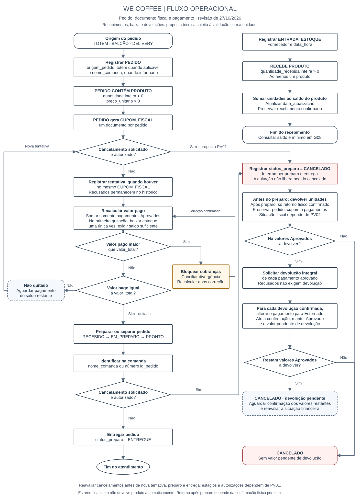
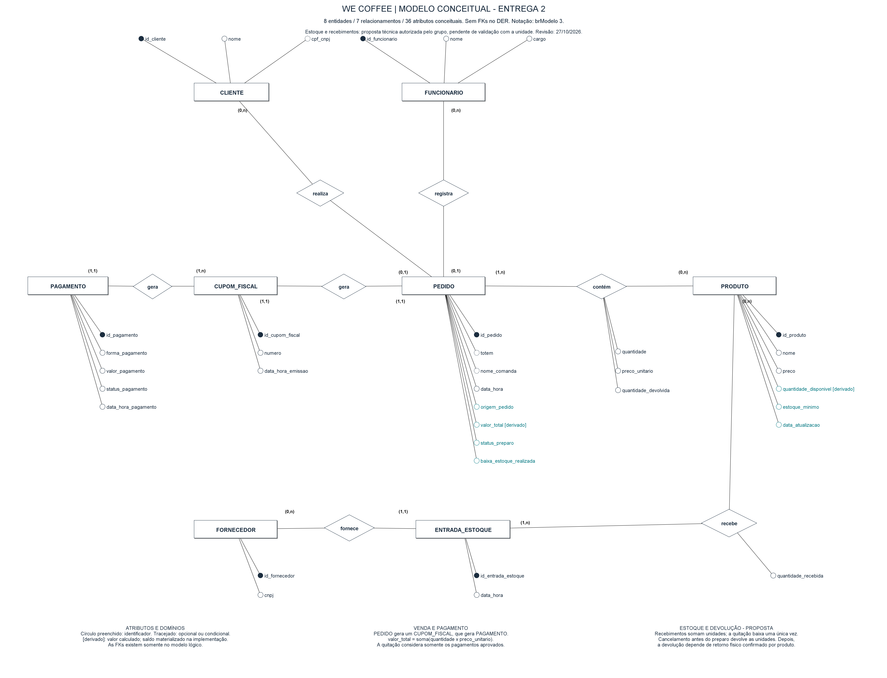
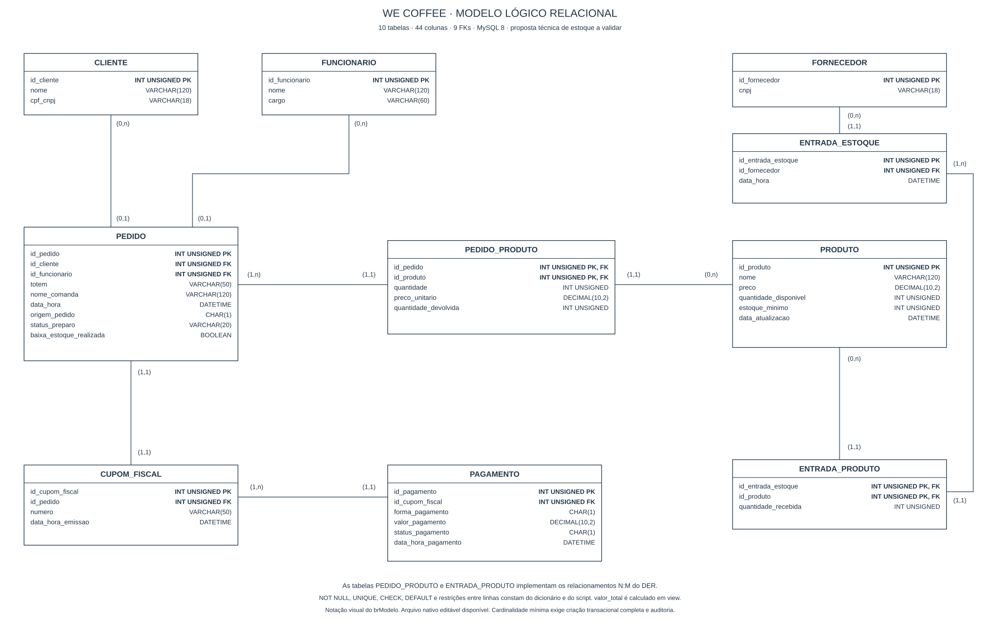

# We Coffee — Entrega 2

Modelo lógico, implementação MySQL e apresentação final. Revisão: **27/10/2026**. Curso: **ADS**.

A base técnica desta versão inclui vendas, recebimentos e estoque. O grupo autorizou a inclusão de estoque e recebimentos **como proposta técnica a validar**, sem uma nova entrevista confirmada. Os arquivos executáveis e os resultados de teste não substituem a comprovação do levantamento nem a aprovação do escopo pelo professor. As pendências estão na seção 5.

| Artefato | Arquivo |
|---|---|
| Relatório técnico final | Este README, na raiz da branch main |
| Levantamento organizado | [levantamento/levantamento.md](levantamento/levantamento.md) |
| Dicionário lógico e físico, em um único HTML | [index.html](index.html) |
| DER conceitual revisado | [PNG](WECOFFE/Modelo_Conceitual_WeCoffee_BRModelo.png) · [PDF](WECOFFE/modelagem/Modelo_Conceitual_WeCoffee_Entrega2.pdf) · [brModelo 3 editável](WECOFFE/modelagem/Modelo_Conceitual_WeCoffee.brM3) |
| Modelo lógico | [SVG](WECOFFE/modelagem/Modelo_Logico_WeCoffee.svg) · [PNG do brModelo](WECOFFE/modelagem/Modelo_Logico_WeCoffee_BRModelo.png) · [brModelo 3 editável](WECOFFE/modelagem/Modelo_Logico_WeCoffee.brM3) |
| Fluxograma | [SVG](WECOFFE/modelagem/Fluxograma_WeCoffee.svg) · [JPG](WECOFFE/modelagem/drawio.jpg) |
| Script completo e massa fictícia | [docs/script.sql](docs/script.sql) |
| Testes de integridade | [docs/testes_integridade.sql](docs/testes_integridade.sql) · [resultado real](docs/resultado_testes.txt) |
| Guia de execução e limitações | [docs/execucao_mysql.md](docs/execucao_mysql.md) |
| Relatório de alterações e próximos passos | [docs/relatorio_entrega2.md](docs/relatorio_entrega2.md) |
| Evidências da execução SQL | [saída das consultas](docs/resultado_execucao_sql.txt) · [contagens](docs/contagens_banco.txt) |
| Relatório de validação | [docs/validacao_entrega2.md](docs/validacao_entrega2.md) |
| Apresentação | [PowerPoint](apresentacao/WeCoffee_Entrega2.pptx) · [roteiro de oito minutos](apresentacao/roteiro.md) |

O arquivo `WeCoffee_BRModelo.pdf` na raiz é uma versão anterior, preservada como histórico. Para a Entrega 2, utilize o PDF atual indicado na tabela acima.

## Integrantes

| Nome completo | RGM | Usuário do GitHub |
|---|---|---|
| Guilherme Souza Lima | 46899502 | Pendente de confirmação pelo grupo |
| João Victor Moidano do Valle | 46576461 | Pendente de confirmação pelo grupo |
| Gabriel Amorim Sartori | 46832939 | Pendente de confirmação pelo grupo |
| Guilherme Cau Guateli | 46736069 | Pendente de confirmação pelo grupo |
| Matheus Fernandes Andrade | 46754539 | Pendente de confirmação pelo grupo |

O repositório informado é [Guilherme-DEV-ALT/BANCO_WECOFFEE](https://github.com/Guilherme-DEV-ALT/BANCO_WECOFFEE). A associação de cada conta ao aluno deve ser confirmada, sem deduzir identidade apenas pelo nome de autor de um commit.

## 1. Relatório Técnico Final

### 1.1 Revisão do Modelo Conceitual

#### Caracterização da organização

Conforme o levantamento registrado pelo grupo, a organização é **MOONLIGHT COFFEE CAFETERIA LTDA.**, nome comercial **We Coffee**, CNPJ **34.706.031/0001-84**. Unidade analisada: **Avenida Paulista, 1111 — Bela Vista, São Paulo/SP**. Trata-se de uma operação comercial de alimentos e bebidas, com fins lucrativos, atendimento por totem, balcão e delivery. O responsável informado é o gerente **Daniel Porrino**, telefone **+55 11 95208-6022**.

O registro anterior informa aproximadamente **seis funcionários**. Quantidade de produtos, pedidos por dia ou mês, recebimentos por período e número de clientes ativos permanecem **pendentes de confirmação**. Nenhum desses volumes foi presumido a partir da massa fictícia. A data da visita e eventual vínculo profissional ou familiar de integrantes com a organização também devem ser informados pelo grupo.

A escolha decorre do acesso relatado à unidade e da variedade dos processos de atendimento, pagamento, preparação, entrega, abastecimento e relacionamento com fornecedores. A organização da Entrega 1 foi mantida.

| Problema | Base disponível | Resposta do modelo e da implementação |
|---|---|---|
| **P1 — Dificuldade de consolidar informações para o fechamento mensal e avaliar vendas** | Relato da entrevista registrado pelo grupo. A data e o material da entrevista ainda precisam ser anexados. | PEDIDO, CONTÉM, CUPOM_FISCAL e PAGAMENTO sustentam G01 a G07 e os KPIs 01 a 08. |
| **P2 — Necessidade de manter a informação de disponibilidade dos produtos coerente com o estoque** | Observação descrita no documento anterior: quando o produto acaba, a equipe confere e atualiza a disponibilidade. O mecanismo proposto de controle ainda depende da unidade. | PRODUTO, ENTRADA_ESTOQUE, RECEBE e CONTÉM sustentam saldo, baixa, devolução e consultas G08/G09; KPIs 09/10. |

**Escopo proposto:** registrar cadastros de clientes, funcionários, produtos e fornecedores; pedidos e suas origens; documentos fiscais e pagamentos; preparo e entrega; recebimentos; saldo, mínimo e devoluções de produtos comercializáveis; e consultas gerenciais. A inclusão do estoque foi autorizada pelo usuário em 27/10/2026 como proposta técnica. A cobertura de todos os processos da unidade ainda precisa de conferência: compras/contas a pagar, escalas, ingredientes e outros processos não podem ser declarados inexistentes sem confirmação. Essa pendência impede afirmar aderência integral ao escopo organizacional exigido pelo professor.

#### Evidências e resumo do levantamento

- [Site oficial informado](https://wecoffee.com.br/) e [link da loja fornecido pelo grupo](https://share.google/shs5jxNxnNAmYuQjz).
- [Foto de presença junto à unidade](levantamento/evidencias/presenca_unidade.jpg), armazenada no repositório. A foto registra presença e fachada; o grupo deve apresentar a comprovação específica da entrevista no local.
- Entrevistado informado: Daniel Porrino, gerente. Data, participantes, roteiro original e foto da entrevista: **pendentes**.
- O relato disponível associa à entrevista a dificuldade de fechamento mensal. O documento anterior associa à observação o atendimento por diferentes canais e a atualização da disponibilidade dos produtos.
- O [levantamento completo organizado](levantamento/levantamento.md) separa esses registros das hipóteses desta proposta e dos dados ainda ausentes. Não houve nova visita ou confirmação de respostas nesta revisão.

#### Processos de negócio

| Processo | Dados envolvidos | Base e tratamento |
|---|---|---|
| Cadastro e identificação | CLIENTE: id_cliente, nome, cpf_cnpj opcional; FUNCIONARIO: id_funcionario, nome, cargo; FORNECEDOR: id_fornecedor, cnpj. | Cadastros preservados do modelo anterior. Não se exige cliente fictício para realizar uma venda. |
| Cadastro de produtos | id_produto, nome, preco, estoque_minimo; quantidade_disponivel e data_atualizacao mantidos pelas operações. | Controle de saldo e mínimo são proposta técnica. |
| Pedido e comanda | id_pedido, data_hora, origem_pedido, totem condicional, nome_comanda, cliente opcional, funcionário obrigatório no balcão; por produto: quantidade, preco_unitario e quantidade_devolvida. | Totem permanece atributo. Quantidade e preço pertencem ao relacionamento CONTÉM. |
| Documento e tentativa de pagamento | CUPOM_FISCAL: id, pedido, numero, data_hora_emissao; PAGAMENTO: id, cupom, forma, valor, status, data_hora_pagamento. | Um pedido gera um cupom; o cupom reúne tentativas e pagamentos divididos. |
| Preparação, entrega e cancelamento | status_preparo e identificação da comanda; pagamentos aprovados, recusados ou estornados. | Fluxo normal preservado. Estágios de cancelamento e devolução financeira são propostas a validar. |
| Recebimento | id_entrada_estoque, fornecedor, data_hora; por produto, quantidade_recebida. | Proposta técnica; não se presume que recebimento seja idêntico à compra ou ao pagamento do fornecedor. |
| Baixa e retorno físico | baixa_estoque_realizada, quantidade, quantidade_devolvida, quantidade_disponivel, data_atualizacao. | Baixa única na quitação; recomposição segundo RN27. |
| Análise gerencial | Datas, totais derivados, origens, situações financeiras, produtos e fornecedores. | Consultas G01 a G09, com rastreabilidade na seção 1.6. |

Processos prováveis ainda não confirmados: compras e contas a pagar, escalas e rotinas de pessoal, fichas técnicas/ingredientes, perdas e inventário, fidelidade e eventual integração com delivery/TOTVS. Permanecem como perguntas no levantamento, e não como ausências comprovadas. O projeto não implementa emissão fiscal oficial nem integração com plataformas externas. Não há evidência para acrescentar entidades específicas dessas funções como se fossem fatos observados.

#### Requisitos funcionais

Os códigos anteriores foram preservados; códigos removidos não foram reutilizados. RF21 a RF25 formalizam a ampliação proposta.

| Código | Requisito com os dados envolvidos |
|---|---|
| RF01 | Cadastrar cliente com id_cliente, nome e cpf_cnpj opcional. |
| RF02 | Cadastrar funcionário com id_funcionario, nome e cargo. |
| RF04 | Cadastrar produto com id_produto, nome, preco e estoque_minimo; saldo e data de atualização são mantidos pelas operações de estoque. |
| RF05 | Registrar pedido com id_pedido, data_hora, cliente opcional, funcionário quando exigido, origem, equipamento, nome de comanda e situação de preparo. |
| RF06 | Identificar origem TOTEM, BALCÃO ou DELIVERY e o equipamento do autoatendimento. |
| RF07 | Associar produtos ao pedido com quantidade inteira positiva. |
| RF08 | Registrar preco_unitario de cada produto na venda, preservando o histórico. |
| RF09 | Registrar tentativas de pagamento com cupom, forma, valor, status e data_hora_pagamento. |
| RF10 | Permitir vários pagamentos no mesmo cupom para dividir a conta. |
| RF13 | Cadastrar fornecedor com id_fornecedor e cnpj e associá-lo aos recebimentos. |
| RF15 | Consultar pedidos, produtos vendidos, documentos fiscais e tentativas de pagamento. |
| RF16 | Consolidar vendas por período, produto e canal, sem duplicar o total de pedidos com vários pagamentos. |
| RF17 | Consultar valor pago, saldo restante, quitação e divergências pela soma dos aprovados. |
| RF18 | Registrar cancelamento e estorno confirmado, preservando as tentativas financeiras. |
| RF19 | Registrar nome_comanda sem exigir CLIENTE; usar id_pedido quando o nome estiver ausente. |
| RF20 | Gerar um CUPOM_FISCAL para cada pedido, com id, numero e data_hora_emissao. |
| RF21 | Registrar recebimento com id_entrada_estoque, fornecedor, data_hora e produtos com quantidade_recebida. |
| RF22 | Consultar quantidade_disponivel e produtos abaixo de estoque_minimo. |
| RF23 | Baixar o estoque uma única vez quando o pedido alcançar quitação exata, registrando baixa_estoque_realizada. |
| RF24 | Registrar quantidade_devolvida por produto de pedido cancelado e recompor o saldo segundo RN27. |
| RF25 | Consolidar unidades recebidas por fornecedor e produto no período. |

#### Requisitos não funcionais

| Código | Requisito e forma de verificação |
|---|---|
| RNF01 | Usabilidade: na futura interface, todos os campos devem ter rótulos e mensagens devem identificar a regra violada. Domínios devem corresponder ao dicionário. Não há interface operacional implementada nesta entrega. |
| RNF02 | Integridade: verificar FKs, unicidade, quantidades, preços, quitação, transições e consistência de estoque. Os testes SQL e auditorias documentam essa verificação. |
| RNF03 | Segurança: definir perfis e operações autorizadas com a unidade e restringir escrita direta de histórico/saldo. A entrega não cria usuários, senhas ou uma aplicação de autenticação. Perfis e permissões de produção dependem de PV05. |
| RNF04 | Desempenho: medir o percentil 95 das consultas de pedido e fechamento, registrando volume e concorrência. Limites de tempo e carga são pendentes em PV05; a massa pedagógica não comprova uma meta de produção. |
| RNF05 | Disponibilidade: definir janela de serviço, manutenção e meta percentual com a unidade. Não há alegação de disponibilidade medida ou hospedagem de produção. |
| RNF06 | Escalabilidade: repetir consultas com volumes crescentes, preservando integridade e os limites acordados em RNF04. Volume-alvo e concorrência dependem de PV05. |

#### Regras de negócio e restrições

RN18, RN19 e RN24 a RN28 são decisões da proposta técnica, sujeitas à validação com a organização. As demais regras refletem o recorte documentado e suas restrições de implementação.

| Código | Regra | Implementação ou verificação |
|---|---|---|
| RN01 | Cada entidade possui identificador próprio, obrigatório e único. | PK de cada tabela. |
| RN02 | CLIENTE pode não estar associado ao pedido; cpf_cnpj é opcional e, quando informado, único. | pedido.id_cliente admite NULL; FK e UNIQUE em cliente.cpf_cnpj. |
| RN03 | Nomes de clientes, funcionários e produtos e o cargo do funcionário não podem ficar vazios. | NOT NULL e CHECK de texto não vazio. |
| RN04 | O preço atual de produto é positivo e monetário, com até duas casas decimais. | DECIMAL(10,2) e CHECK preco>0. |
| RN05 | Cada pedido contém ao menos um produto; quantidade é inteira e positiva. | PK composta, FKs, INT UNSIGNED, CHECK; criação transacional e A01. |
| RN06 | O preço unitário da venda é positivo e preservado com a quantidade após a primeira tentativa de pagamento. | DECIMAL, CHECK e triggers em pedido_produto; validação de centavos na rotina. |
| RN07 | A origem é TOTEM, BALCÃO ou DELIVERY; o equipamento só é preenchido na origem TOTEM. | Códigos T/B/D e CHECK de uso condicional de totem. |
| RN08 | Pedido de balcão exige funcionário cadastrado. Nas demais origens o vínculo não é obrigatório. | FK opcional e CHECK para origem B. |
| RN09 | O nome da comanda é opcional; em sua ausência, a chamada utiliza id_pedido. | NULL e COALESCE na view. |
| RN10 | Todo pedido gera exatamente um CUPOM_FISCAL; número do documento é único na unidade. | FK, UNIQUE de id_pedido e numero; sp_criar_pedido e A02. |
| RN11 | O cupom possui uma ou mais tentativas de pagamento; cada tentativa pertence a um cupom. | FK, rotina transacional com JSON não vazio e A03. Mínima 1 sujeita a PV03. |
| RN12 | Cada tentativa tem uma forma e um status previstos no domínio. | Formas P/C/D/X e status A/R/E em CHECK; inserção admite somente A ou R. |
| RN13 | Cada valor de pagamento é positivo e expresso em centavos. | DECIMAL e CHECK; rotina rejeita fração de centavo antes da conversão. |
| RN14 | Somente pagamentos Aprovados compõem o valor pago; Recusados e Estornados são excluídos. | Agregação CASE nas views. |
| RN15 | Quitação exige valor pago igual ao total; valor excedente é divergência e bloqueia preparo. | Views e trigger de transição; A04 detecta excedente. |
| RN16 | Uma recusa não cancela o pedido nem desfaz aprovações; nova tentativa gera novo registro. | Histórico de pagamento imutável e nova linha. |
| RN17 | O preparo segue RECEBIDO, EM_PREPARO, PRONTO e ENTREGUE; cada avanço exige quitação e baixa. | CHECK e trigger de transições. |
| RN18 | Proposta: cancelar antes da entrega, interrompendo o atendimento e preservando os registros. | sp_cancelar_pedido e bloqueio de retorno de CANCELADO; validar estágios em PV01. |
| RN19 | Proposta: pagamento aprovado de pedido cancelado passa a Estornado apenas após devolução financeira integral confirmada. | Trigger aceita somente A para E em pedido CANCELADO; confirmação é responsabilidade do operador. |
| RN20 | Identidade da venda, documento e dados originais das tentativas financeiras são preservados. | Triggers bloqueiam reatribuição, edição de valor/data/forma e alteração do cupom. |
| RN21 | A emissão não antecede o pedido; a tentativa financeira não antecede o pedido nem o cupom. | Triggers de cronologia e A07. |
| RN22 | Proposta: relatório de vendas agrupa pelo mês de registro do pedido e pelo estado atual. | G01 a G07; não representa fechamento histórico imutável. |
| RN23 | Pedidos, documentos, tentativas e recebimentos permanecem no histórico; não são apagados como cancelamento. | Triggers de DELETE e FKs RESTRICT; DELETE demonstrativo usa produto sem vínculo. |
| RN24 | Proposta: cada recebimento possui fornecedor e ao menos um produto com quantidade inteira positiva; registro confirmado é preservado. | entrada_estoque, entrada_produto, rotina transacional, triggers e A11. |
| RN25 | Proposta: saldo disponível e estoque mínimo são não negativos; saldo inicia em zero. | INT UNSIGNED, DEFAULT 0 e baixa condicional com saldo suficiente. |
| RN26 | Proposta: a primeira quitação baixa todas as unidades uma única vez, na mesma transação local do registro de aprovação. | Trigger de pagamento, sp_baixar_estoque e baixa_estoque_realizada. Recusa e pagamento parcial não baixam. |
| RN27 | Proposta: cancelamento antes do preparo devolve todas as unidades baixadas. Depois do preparo, só retorna a quantidade fisicamente confirmada, até o limite vendido. Estorno financeiro não devolve produto automaticamente. | sp_cancelar_pedido, quantidade_devolvida, trigger e A08/A10. |
| RN28 | O saldo materializado deve corresponder a recebimentos menos unidades baixadas ainda não devolvidas. | Atualização transacional e auditoria A08; aplicação deve restringir escrita direta do saldo. |

Domínios conceituais: origem TOTEM/BALCÃO/DELIVERY; preparo RECEBIDO/EM_PREPARO/PRONTO/ENTREGUE/CANCELADO; pagamento Aprovado/Recusado/Estornado. A proposta física usa origem T/B/D, forma P=PIX, C=Crédito, D=Débito, X=Dinheiro e status A/R/E, com comparação sensível a maiúsculas. Valores monetários usam reais e centavos exatos. Preço zero e quantidade fracionária não fazem parte deste recorte.

#### DER revisado e convenções

**Software:** motor oficial do **brModelo 3**, com arquivo nativo .brM3 editável e validado por reabertura. O DER segue a notação do esqueleto: entidades em retângulos, relacionamentos em losangos, identificadores preenchidos, atributos ligados aos elementos e cardinalidades mínimas/máximas nos dois lados. **Não há FKs no conceitual.**

Há **oito entidades, sete relacionamentos e 36 atributos conceituais**. Os relacionamentos N:M PEDIDO—CONTÉM—PRODUTO e ENTRADA_ESTOQUE—RECEBE—PRODUTO possuem atributos no losango. As tabelas associativas aparecem somente no modelo lógico. Os atributos são simples e monovalorados neste recorte. Identificadores distinguem entidades; opcionais/condicionais são indicados na legenda. valor_total é derivado em consulta. quantidade_disponivel é derivada dos movimentos e materializada no modelo físico, com auditoria da fórmula.

A mínima 1 de pagamentos por cupom foi mantida conforme o recorte anterior e implementada pela criação transacional com uma primeira tentativa, que pode ser recusada. Se a unidade precisar persistir cupom antes de qualquer tentativa, rever a mínima para 0 e ajustar DER, rotina e auditoria (PV03).

#### Registro das revisões da Entrega 1

A correção oficial do professor não foi disponibilizada. A tabela abaixo rastreia os apontamentos e solicitações disponíveis nesta conversa; deve ser complementada com **cada apontamento real da correção**, inclusive os que o grupo decidir contestar com justificativa.

| Apontamento disponível | O que mudou | Por quê |
|---|---|---|
| Requisitos sem identificação | RF/RNF preservados e RN01 a RN28 acrescentados. | Relacionar restrições e auditorias às regras. |
| Nomes de fornecedor incorretos | id_fornecedor e cnpj preservados em todos os artefatos. | Representar corretamente o identificador e o documento. |
| Divisão e recusa de pagamento | Cupom 1:N pagamento; soma apenas de aprovados e histórico de recusas. | Representar divisão da conta e situação financeira. |
| Totem como entidade e múltiplas linhas pedido–produto | Totem como atributo; único CONTÉM com atributos. | Manter as decisões do grupo sem entidades artificiais. |
| Atributos e FKs no conceitual | Círculos e losangos na notação brModelo; FKs apenas no lógico. | Atender à convenção explícita do esqueleto da Entrega 2. |
| Estoque e recebimentos retirados na revisão anterior | Reintroduzidos como proposta autorizada pelo usuário para a Entrega 2. | Ampliar a cobertura dos processos; confirmar o funcionamento com a unidade. |
| Fechamento e cancelamento pouco definidos | Views, rotinas, consultas e limitações documentadas. | Evitar duplicação de totais e confusão entre estorno financeiro e retorno físico. |

### 1.2 Conversão do Modelo Conceitual para o Modelo Lógico

| Origem conceitual | Conversão relacional |
|---|---|
| CLIENTE, FUNCIONARIO, PRODUTO e FORNECEDOR | Uma tabela por entidade, com seus atributos próprios. |
| PEDIDO | Tabela com cliente/funcionário como FKs, dados da comanda, origem e estado operacional. valor_total permanece em view. |
| CUPOM_FISCAL | Tabela com id_pedido obrigatório e UNIQUE, implementando o máximo 1:1. A existência do cupom é assegurada pela rotina e auditada. |
| PAGAMENTO | Tabela com FK obrigatória para cupom; várias linhas no mesmo cupom. |
| CONTÉM N:M | pedido_produto, com PK composta (id_pedido,id_produto), quantidade, preco_unitario e quantidade_devolvida. Um produto é consolidado em uma linha por pedido neste recorte. |
| ENTRADA_ESTOQUE | Tabela com FK obrigatória de fornecedor e data do recebimento. |
| RECEBE N:M | entrada_produto, com PK composta (id_entrada_estoque,id_produto) e quantidade_recebida. |
| Saldo derivado | produto.quantidade_disponivel materializa recebimentos menos baixas líquidas de devolução. Atualização por rotinas e conferência por A08. |

Relacionamentos 1:N tornam-se FKs no lado N; opcionais admitem NULL. O requisito de funcionário no balcão complementa a cardinalidade geral com CHECK. N:M exige tabela de ligação no relacional. Não há generalização/especialização a converter no DER atual. As mínimas de participação em tabelas-filhas não são garantidas por uma FK no sentido inverso: as rotinas publicam registros completos em uma transação e A01/A02/A03/A11 detectam bypass administrativo.

### 1.3 Definição de Chaves Primárias e Estrangeiras

| Tabela | PK | FKs | Unicidade adicional |
|---|---|---|---|
| cliente | id_cliente | — | cpf_cnpj |
| funcionario | id_funcionario | — | — |
| produto | id_produto | — | — |
| fornecedor | id_fornecedor | — | — |
| pedido | id_pedido | id_cliente → cliente.id_cliente; id_funcionario → funcionario.id_funcionario | — |
| pedido_produto | id_pedido + id_produto | id_pedido → pedido.id_pedido; id_produto → produto.id_produto | — |
| cupom_fiscal | id_cupom_fiscal | id_pedido → pedido.id_pedido | id_pedido; numero |
| pagamento | id_pagamento | id_cupom_fiscal → cupom_fiscal.id_cupom_fiscal | — |
| entrada_estoque | id_entrada_estoque | id_fornecedor → fornecedor.id_fornecedor | — |
| entrada_produto | id_entrada_estoque + id_produto | id_entrada_estoque → entrada_estoque.id_entrada_estoque; id_produto → produto.id_produto | — |

As chaves artificiais preservam a identidade interna quando nomes ou documentos mudam. As chaves compostas impedem repetir o mesmo produto no pedido ou recebimento e identificam atributos que pertencem ao par. cpf_cnpj é uma unicidade opcional, não substitui a PK. O CNPJ de fornecedor não foi tratado como PK nem recebeu unicidade não prevista no levantamento.

### 1.4 Processo de Normalização (1FN, 2FN e 3FN)

| Etapa | Aplicação concreta |
|---|---|
| 1FN | Produtos e pagamentos repetidos não ocupam listas em colunas. Cada associação e tentativa ocupa uma linha. JSON é apenas formato de entrada das rotinas e é convertido em linhas; nenhuma tabela armazena uma lista JSON. |
| 2FN | Em pedido_produto, (id_pedido,id_produto) determina quantidade, preco_unitario e quantidade_devolvida. Nome e preço atual dependem só de id_produto e ficam em produto. Em entrada_produto, o par determina quantidade_recebida; fornecedor e data dependem só da entrada e ficam em entrada_estoque. |
| 3FN | id_pedido determina id_cliente, mas nome e documento do cliente ficam em cliente. id_cupom_fiscal determina id_pedido, por isso pagamento não repete id_pedido. id_entrada_estoque determina id_fornecedor, cujo CNPJ fica em fornecedor. Os demais atributos próprios dependem da PK da respectiva tabela. |

Dependências funcionais centrais: id_cliente → nome, cpf_cnpj; id_funcionario → nome, cargo; id_produto → nome, preco, estoque_minimo; id_pedido → referências e dados do pedido; id_cupom_fiscal → id_pedido, numero, data_hora_emissao; id_pagamento → cupom, forma, valor, status, data; id_entrada_estoque → fornecedor, data; e as duas dependências dos pares citadas em 2FN.

nome_comanda é uma identificação registrada naquela compra, podendo existir sem cliente e permanecer diferente de um cadastro posteriormente editado; não é uma cópia obrigatória do nome do cliente. valor_total não é coluna armazenada. O saldo é uma **materialização deliberada** de uma informação calculável entre tabelas, não uma origem adicional para movimentos: as rotinas o mantêm e a auditoria A08 confronta sua fórmula. Essa escolha e a necessidade de restringir escrita direta são documentadas; a normalização não dispensa esse controle.

### 1.5 Justificativas Técnicas das Decisões

MySQL/InnoDB fornece transações, FKs e locks de linha. O script utiliza CHECK efetivamente aplicado, exigindo MySQL 8.0.16 ou superior, e foi executado no 8.4.13. Tipos monetários são DECIMAL; IDs e quantidades usam inteiros sem sinal. As datas são DATETIME no horário de referência de São Paulo, sem conversão automática de fuso; o grupo deve manter essa convenção na entrada.

A tabela de RN identifica as restrições e mecanismos. FKs usam RESTRICT para preservar histórico. UNIQUE de cupom.id_pedido impede dois documentos para a mesma venda. Campos opcionais são NULL, não strings vazias ou clientes fictícios. CHECK implementa origem, equipamento condicional, funcionário de balcão, valores positivos e domínios; triggers implementam transições, imutabilidade, cronologia e efeitos sobre estoque. O dicionário documenta DEFAULT, NULL e limites físicos por coluna.

A baixa usa atualizações condicionais de saldo e ocorre na mesma transação local da aprovação registrada; falta de saldo aborta toda essa operação. A bandeira de baixa impede segunda redução. A sequência de produtos por id reduz risco de deadlock, mas concorrência e retomada após deadlock exigem validação de aplicação. Não há integração com adquirente: uma confirmação financeira externa seguida de falha local precisaria de tratamento de conciliação antes de uso real.

A aplicação deve utilizar as rotinas para criação completa e cancelamento e receber privilégios mínimos; contas e perfis reais dependem da unidade. Escrita administrativa direta pode ignorar rotinas de participação mínima ou modificar o saldo materializado: as auditorias detectam inconsistências, mas não substituem permissões. Não se declara que autenticação ou isolamento de acesso de produção foram implementados.

### 1.6 Proposta de Arquitetura Analítica para BI e IA

O banco operacional alimenta consultas de leitura por meio das views de total, pagamentos e situação. A proposta de BI é extrair os resultados para uma área analítica separada, com acesso de leitura, dimensões de data, produto, canal e fornecedor e fatos de vendas/recebimentos. Pedidos e suas linhas devem ter granularidades separadas: agregar o total de um pedido após juntar seus vários produtos e pagamentos geraria duplicação.

| Código | Indicador | Fórmula | Período | Tabelas/base | Consulta |
|---|---|---|---|---|---|
| KPI01 | Vendas quitadas | Soma de valor_total dos pedidos não cancelados e quitados | Mês do pedido | pedido, pedido_produto, cupom_fiscal, pagamento | G01 |
| KPI02 | Ticket médio | Vendas quitadas / quantidade de pedidos quitados | Mês do pedido | Mesmas de KPI01 | G01 |
| KPI03 | Unidades vendidas por produto | Soma de quantidade nas vendas quitadas | Período do pedido | pedido_produto, produto e views de situação | G02 |
| KPI04 | Participação por origem | Pedidos quitados do canal / pedidos quitados do período × 100 | Período do pedido | pedido e views de situação | G03 |
| KPI05 | Taxa de cancelamento | Pedidos CANCELADO / pedidos registrados × 100 | Mês do pedido | pedido | G04 |
| KPI06 | Devolução financeira pendente | Soma dos aprovados ainda vinculados a pedidos cancelados | Mês do pedido, estado atual | pedido, cupom_fiscal, pagamento | G05 |
| KPI07 | Taxa de recusa | Tentativas Recusadas / total de tentativas × 100 | Período do pedido, por forma | pagamento, cupom_fiscal, pedido | G06 |
| KPI08 | Recompra por cliente | Contagem de compras quitadas por cliente; recompra quando contagem ≥ 2 | Período do pedido | cliente e views de situação | G07 |
| KPI09 | Produtos abaixo do mínimo | Contagem dos produtos cujo saldo é menor que estoque_minimo | Situação atual | produto | G08 |
| KPI10 | Unidades recebidas | Soma de quantidade_recebida por fornecedor e produto | Período do recebimento | fornecedor, entrada_estoque, entrada_produto, produto | G09 |

As metas devem ser definidas com o responsável; nenhuma meta de negócio foi inventada. G07 entrega a contagem individual que permite classificar clientes com duas ou mais compras, preservando os clientes sem compra por LEFT JOIN. G08 entrega os produtos que compõem a contagem de itens abaixo do mínimo.

| Problema | Tabelas envolvidas | Consultas no script |
|---|---|---|
| P1 — Fechamento mensal e avaliação das vendas | pedido, pedido_produto, produto, cliente, cupom_fiscal, pagamento | G01–G07; cada KPI01–KPI08 tem seu código de consulta na tabela acima. |
| P2 — Disponibilidade coerente com estoque | produto, pedido, pedido_produto, fornecedor, entrada_estoque, entrada_produto | G08 e G09; KPI09 e KPI10. |

**Limite temporal:** os relatórios mensais representam o estado atual dos pedidos agrupado pela data da compra. Um estorno posterior altera a soma atual de um mês anterior. O modelo não registra data de estorno, cancelamento ou devolução física, nem o histórico completo de mudanças; não reconstrói fechamento imutável ou estoque passado. É necessário acrescentar eventos com datas em uma revisão validada, se essa necessidade for confirmada. A emissão de documento fiscal é representação acadêmica, sem pretensão de produzir documento fiscal oficial.

**IA proposta:** previsão de demanda por produto e origem exigiria histórico real autorizado, períodos representativos e validação fora da amostra; recomendação de reposição poderia combinar demanda e mínimo. Não há modelo de IA treinado, e os 120 pedidos fictícios não comprovam capacidade preditiva. A minimização dos dados deve evitar levar documentos de clientes para painéis gerenciais sem necessidade.

## 2. Modelo Lógico Relacional

O modelo possui **dez tabelas, 44 colunas e nove FKs**. O arquivo editável foi produzido com o motor oficial do brModelo 3 e suas classes de tabela/campo/constraint. A visualização SVG apresenta a mesma estrutura na notação visual solicitada, com nomes à esquerda, tipos e marcas PK/FK à direita e cardinalidades nos dois lados. O PNG corresponde à renderização do motor nativo, que também usa ícones para as chaves. As demais restrições estão no HTML e no SQL.

## 3. Script SQL Completo

[docs/script.sql](docs/script.sql) contém CREATE DATABASE, dez CREATE TABLE, constraints, views, triggers, rotinas, INSERTs da carga, SELECT com JOIN, UPDATE e DELETE demonstrativos com ROLLBACK, nove consultas gerenciais G01–G09 e onze auditorias A01–A11. Cada consulta contém pergunta e códigos atendidos. O banco dedicado não é apagado automaticamente: executar em ambiente vazio ou escolher outro nome, conforme o [guia](docs/execucao_mysql.md).

A implementação foi executada em MySQL 8.4.13 e os [31 testes](docs/resultado_testes.txt) passaram. As rejeições conferem o SQLSTATE real, não apenas uma mensagem genérica. A04 retorna intencionalmente o pedido 120 com total R$47,00 e aprovado R$47,01. Esse caso demonstra a detecção de divergência e permanece bloqueado para preparo; não é uma falha de cálculo não identificada. As demais auditorias devem retornar zero ocorrências na massa original.

## 4. Massa de Dados

A carga está incluída no script: **20 clientes, seis funcionários, 12 produtos, dois fornecedores, três recebimentos, 14 associações de recebimento, 120 pedidos, 270 associações de venda, 120 cupons e 165 tentativas de pagamento**. Os registros são inteiramente fictícios. Documentos são marcadores de teste e não foram validados como CPF/CNPJ oficiais; o script verifica presença/tamanho e unicidade opcional de cliente, não dígitos verificadores nem todas as regras legais do cadastro.

Os pedidos cobrem julho a setembro de 2026, com 40 por mês, **apenas para exercício**. A carga inclui 86 entregues, seis em preparo, seis prontos, seis com recusa sem aprovação, seis parcialmente pagos, nove cancelados com tratamentos distintos e uma divergência. Há origens T/B/D, pagamentos divididos, nova tentativa após recusa, cliente ausente, nome de comanda ausente, clientes sem compras, produtos abaixo do mínimo e retorno físico parcial após preparo.

O número de funcionários acompanha a aproximação registrada no levantamento. Os demais tamanhos foram escolhidos para cobertura dos testes, não derivados de volume real ainda desconhecido. **O dimensionamento exigido pelo professor continua pendente**: o grupo deve confirmar os volumes e ajustar a quantidade por tabela ou justificar o período amostrado. Não se apresenta esta massa como retrato estatístico da loja. O uso de IA na geração está registrado na seção 6.

## 5. Repositório GitHub e Pendências

A correção considera exclusivamente a branch main. Os artefatos devem ser commitados e enviados, com links funcionais a partir deste README. O histórico já possui autores e aliases diferentes; é necessário confirmar a conta de cada integrante e distribuir as contribuições do grupo de forma identificável. Não foi presumida identidade a partir de um alias, nem criada colaboração fictícia.

| Código | Pendência real | Como concluir |
|---|---|---|
| PV01 | Regras de cancelamento, estorno e conciliação | Confirmar autorizadores, estágios permitidos e como lidar com aprovação externa ou valor excedente. |
| PV02 | Documento fiscal após cancelamento | Confirmar o procedimento observado e a necessidade de representar o status fiscal. |
| PV03 | Persistência antes da primeira tentativa | Confirmar se cupom pode existir sem tentativa e decidir entre mínima 1 ou 0. |
| PV04 | Fechamento mensal | Validar data de referência e necessidade de histórico imutável e eventos com data. |
| PV05 | Segurança e metas técnicas | Definir perfis, janela de serviço, limites de resposta, disponibilidade e carga de referência. |
| PV06 | Levantamento e evidências | Completar data, participantes, foto da entrevista, material do levantamento, volumes e vínculos do grupo. |
| PV07 | Correção da E1 e escopo integral | Anexar os apontamentos oficiais e confirmar cobertura de todos os processos reais. A exigência de notação brModelo sem FKs conceituais já está esclarecida pelo esqueleto. |
| PV08 | Operação real de estoque e recebimento | Validar SKU/ingredientes, momento da baixa, retorno físico, mínimos, perdas, inventário e processo do fornecedor. A proposta técnica não é entrevista confirmada. |
| PV09 | Identificação e revisão final | Completar usuários GitHub, conferir o HTML contra o PDF-exemplo não disponibilizado e ensaiar a defesa. |

Nenhuma pendência externa foi apresentada como resolvida pelo teste técnico. A foto de presença não foi renomeada conceitualmente como foto de entrevista. Fotos adicionais devem ficar como JPG/PNG dentro do repositório.

## 6. Uso de Inteligência Artificial

A documentação inicial registra ChatGPT GPT-5.6 Luna. As revisões de arquivos e esta implementação utilizaram Codex com ferramentas locais e documentação primária. O grupo deve complementar os registros de usos realizados fora desta conversa.

| Etapa | Motivação e prompt disponível | Resposta, decisões e verificação |
|---|---|---|
| Revisão da Entrega 1 | Solicitações de numerar RF/RNF, corrigir fornecedor, detalhar pagamentos, representar N:M com atributos, colocar totem em PEDIDO e remover estoque naquela versão. | Textos e diagramas revisados; a decisão antiga de estoque foi substituída pela nova autorização da Entrega 2, sem apagar essa distinção. |
| Comparação com o esqueleto | Pedido: “Sem realizar nenhuma alteração no projeto, me diga o que falta ... após isso me mostre os passos em tópicos de como fazer”. | Comparação dos arquivos com o esqueleto, identificação de lacunas e proposta de sequência. Nenhum dado de campo novo foi obtido. |
| Implementação da Entrega 2 | Pedido: “Realize isso pra mim, e logo após me mande tudo documentado por email”. Confirmação: “Incluir estoque e recebimentos como proposta técnica a validar”; dados de campo pendentes; curso ADS. | Dez tabelas, consultas, massa fictícia, testes, dicionário, diagramas e apresentação. Preservados N:M conceituais e totem como atributo. |
| SQL e testes | Apoio à conversão, integridade financeira/estoque e cobertura de cenários, dentro do pedido anterior. | Validada execução real no MySQL. O tratamento de diagnóstico dos testes foi corrigido para exigir SQLSTATE não nulo. Quantidades fracionárias e preços com fração de centavo são rejeitados antes da conversão. |
| Massa fictícia | Criar casos suficientes para consultas e auditorias sem usar registros reais. | 120 pedidos e cenários descritos na seção 4. Quantidade explicitamente pedagógica; volume real permanece pendente. |
| Diagramas, BI e slides | Organizar o modelo lógico e um pitch de oito minutos com as consultas implementadas. | Tipos/chaves derivados do SQL; apenas indicadores com consulta correspondente. Previsão de demanda é possibilidade futura, não resultado demonstrado. |

**Fontes verificadas:** esqueleto fornecido pelo usuário; documentos atuais do grupo; documentação oficial [MySQL: triggers](https://dev.mysql.com/doc/refman/8.4/en/trigger-syntax.html), [downloads MySQL 8.4](https://dev.mysql.com/downloads/mysql/8.4.html); [código oficial brModelo](https://github.com/chcandido/brModelo/tree/0cbda0225d9fbbff54469e06a99c21fee4e680d5); [LGPD, texto oficial](https://www.planalto.gov.br/ccivil_03/_ato2015-2018/2018/lei/l13709.htm). As fontes técnicas não comprovam como a unidade opera.

**Reflexão crítica:** uma sugestão de IA não equivale a observação nem confirmação do responsável. A escolha final deve conciliar o levantamento, a correção do professor e os testes. Cadastros, regras e volumes ainda não comprovados permanecem identificados como proposta ou pendência. Não foram inventadas entrevistas, usuários GitHub, medições ou resultados de execução.

## 7. Apresentação Corporativa Final

A [apresentação editável](apresentacao/WeCoffee_Entrega2.pptx) e o [roteiro](apresentacao/roteiro.md) seguem a ordem do esqueleto: problema, solução, modelo lógico, implementação em execução, consultas, BI/IA e benefícios. O tempo planejado é oito minutos, com demonstração das mesmas consultas do script. Os resultados exibidos usam dados fictícios e não representam desempenho comercial real.

Todos os integrantes devem estar presentes e preparados para responder individualmente sobre modelo, normalização, restrições, consultas e limitações. A defesa ocorre após o pitch. O grupo precisa ensaiar os tempos e confirmar os participantes; a criação dos slides não comprova ensaio nem presença.
